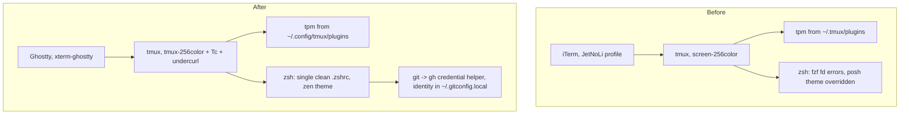

# Mac Starting State - Plan

## Goal Capsule

- **Objective:** Jet can open a terminal on this Mac and start working the same day. Jet starts tmux in Ghostty with correct colours, the shell starts cleanly, and `git push` to personal GitHub repos works through `gh`.
- **Means:** Port the portable, Mac-relevant parts of the work dotfiles into this repo as plain macOS-only config, plus a short bootstrap script (KTD1, KTD2).
- **Authority:** The user's confirmed scope from this session comes first, then this plan, then the origin findings doc. The origin doc's per-package findings are evidence, not instructions. Where this plan disagrees with it (KTD4, KTD6), this plan wins.
- **Stop conditions:** Stop and ask if a stow conflict would overwrite a real file other than `~/.gitconfig`. Also stop if any step would touch the uncommitted nvim or `scripts/` edits, or if the Xcode license is still not accepted when U6 runs.
- **Execution profile:** Config-only change with no automated test suite. Each unit is verified by hand on this machine (see Verification Contract).
- **Finishing:** `ce-work` implements U1–U7 on a new branch and publishes the U8 explainer. Jet runs `sudo xcodebuild -license accept` and `gh auth login` interactively.

---

## Product Contract

### Summary

Add a Ghostty package and a `git` package to this repo, bring tmux up to the work repo's terminal and plugin-path fixes, and replace `.zshrc` with a cleaned-up single file. Add a macOS-only `install.sh` that installs what's missing and stows everything. Then cut this laptop over from iTerm and publish a page explaining the before/after flows and the bugs found along the way.

### Problem Frame

This laptop still runs iTerm with a tmux config that predates the work machine's fixes (`screen-256color`, no truecolor, tpm loaded from the legacy `~/.tmux/plugins` path while a second copy sits under `~/.config/tmux/plugins`). The shell config has drifted too, and some of that drift is outright bugs: lowercase `visual`, a second `oh-my-posh init` that overrides the zen theme, and an fzf `fd` command that errors out. HTTPS pushes currently go through Homebrew git's system `osxkeychain` helper (`/opt/homebrew/etc/gitconfig`). `gh` isn't installed, so the `gh`-managed credential flow the work machine uses isn't available here. Homebrew is half-blocked because the Xcode license was never accepted.

The longer-term goal is one repo shared by the Mac and the Ubuntu work machine (see origin). That's deliberately not this plan. Jet wants a working baseline now and will decide the cross-machine design later.

### Key Decisions

- **This repo is updated on its own; no shared-repo structure yet.** (session-settled: user-directed — chosen over settling the origin doc's shared-repo question (options a/b/c) now: get the laptop usable first, design cross-machine later.) Governs R1, R9.
- **Uncommitted work is out of scope.** (session-settled: user-directed — chosen over committing, stashing or discarding the `rework-nvim` edits first: Jet will handle them separately.) The one overlap is `zsh/.zshrc`. Jet approved rewriting it and keeping the three uncommitted lines (mason bin, Tailscale, `~/.local/bin`). Governs R3, R10.
- **nvim is not changed.** (session-settled: user-approved — chosen over rebasing nvim onto the work config: that would overwrite in-progress edits.) Governs R10.
- **Keep JetBrains Mono Nerd Font.** (session-settled: user-approved — chosen over installing MesloLGL to match the work machine: already installed, and matching fonts is a cross-machine concern.) Governs R2.
- **Add a before/after explainer page.** (session-settled: user-directed — scope addition after the scope was confirmed.) Governs R11.

### Requirements

**Terminal**
- R1. Ghostty is installed and configured from a tracked `ghostty` package, macOS-only, with no per-OS include files.
- R2. Ghostty matches the work look: Catppuccin Mocha, `#303446` background, vivid palette, minimum contrast. It uses JetBrains Mono Nerd Font at the size iTerm uses today.
- R3. Mouse-wheel scrolling works in tmux panes inside Ghostty, including a pane running Claude Code.

**tmux**
- R4. tmux advertises `tmux-256color` with truecolor and undercurl passthrough for Ghostty.
- R5. tpm and plugins load from `~/.config/tmux/plugins` only. The legacy `~/.tmux/plugins` copy is removed.
- R6. tmux keeps the Mac's current binds (`m`, `N`, `M`, `t`, `g`) and gains the portable work binds: `detach-on-destroy off`, explicit `p`, `A` for lazydocker, `E` respawn, plus copy-mode copy to the macOS clipboard.

**Shell and git**
- R7. A new interactive zsh starts without errors or warnings, and the zen oh-my-posh theme is the one that renders.
- R8. The tracked git config holds no user identity. Identity lives in an untracked `~/.gitconfig.local`, and HTTPS credentials come from `gh` resolved on PATH.

**Bootstrap and scope**
- R9. One script installs the missing tools and stows all packages into `$HOME`, and is safe to re-run.
- R10. No nvim files and no uncommitted `scripts/` changes are modified or committed by this work.
- R11. After implementation, a published HTML page explains the terminal, shell and git flows before and after, and lists the bugs and improvement areas found.

### Success Criteria

- Jet opens Ghostty, starts tmux, opens nvim and runs a `git push` to a personal repo without hitting any setup error.
- iTerm is no longer needed for daily work (the aerospace `alt-i` bind opens Ghostty).

### Scope Boundaries

- No per-OS split (`config-macos`/`config-linux`, `.zshrc.$(uname)`, `tmux.$(uname).conf`). Files are written for macOS only.
- No `.zshrc.local` convention beyond sourcing it if present (one line, borrowed from the work repo, cheap and forward-compatible).
- Nothing `wb`- or Sportable-specific (see origin "Out of scope").

#### Deferred to Follow-Up Work

- Cross-machine design: which repo is shared, per-OS splits, cross-OS `install.sh`, git identity via `includeIf` (origin decisions 1 and 3).
- nvim rebase onto the work config, including the clipboard probe and `claude-tmux` guarding (origin "nvim").
- `claude` package: portable skills, statusline, curated `CLAUDE.md`, tracked `settings.json` (origin "claude").
- `session.sh`/`notes.sh` merge with the work versions, `lib.sh`, and deciding on `ewails.sh`/`ms-clients.sh` (origin "scripts").
- tmux agent binds and `claude-status.sh` status-left (with the `wb` port).

---

## Planning Contract

### Key Technical Decisions

- KTD1. **Plain macOS-only files, copied and trimmed from the work repo, with no OS conditionals.** Instantiates the "updated on its own" Key Decision (R1, R9). Adding `if-shell`/`config-file ?…` scaffolding now would mean designing the cross-machine layout early. Where the work file has a Linux-only line (`wl-copy`, `window-decoration`, `fdfind`), replace or drop it rather than guarding it.
- KTD2. **`install.sh` is a short Mac bootstrap, not the work repo's cross-OS script.** It checks the Xcode license and exits with the fix command if it's not accepted. It `brew install`s only what's missing (`ghostty` cask, `gh`), clones tpm under `~/.config/tmux/plugins` if absent, and runs `stow -t "$HOME"` per package. Skip docgen hooks, `default-browser.sh`, the `claude` package and `Lazy! restore` (nvim is out of scope). Pattern: the work repo's `install.sh`.
- KTD3. **Copy-mode copies with explicit `pbcopy` binds, and `set-clipboard on` stays.** Explicit binds behave predictably whether or not OSC52 passes through. Swap `wl-copy` for `pbcopy` in the work repo's two `copy-pipe-and-cancel` binds. Testing whether OSC52 alone is enough is a cross-machine question, deferred.
- KTD4. **Leave `macos-option-as-alt` unset (Ghostty default).** This departs from the origin doc. iTerm's profile has `Option Key Sends = 0` (normal Option), so Jet's current muscle memory types Option characters, not Alt. Matching iTerm avoids a behaviour change on day one. Note it in the U8 page as something to revisit.
- KTD5. **Font is `JetBrainsMono Nerd Font` (the non-Mono variant), size 16.** The installed files are `JetBrainsMonoNerdFont-*.ttf`. The work config's comment explains why the non-Mono variant matters: oh-my-posh powerline glyphs expect natural-width icons. iTerm uses size 16 today. Confirm the family name with `ghostty +list-fonts` during implementation.
- KTD6. **Keep `CLAUDE_CODE_DISABLE_MOUSE=1` unless testing shows it's unnecessary.** This replaces the scope call-out that said it would be removed. The variable controls Claude Code's own mouse capture, which would still steal the wheel inside tmux under any terminal. The origin doc's "wrong layer" reading is plausible only if the iTerm profile was the real cause. U7 tests with it unset in a Claude Code pane under Ghostty and removes the line only if the wheel still scrolls tmux.
- KTD7. **Git identity moves to `~/.gitconfig.local` through `[include]` at the end of `git/.gitconfig`.** The credential helper is `!gh auth git-credential`, resolved from PATH (the work file hard-codes `/usr/bin/gh`). Keep the existing `push.autoSetupRemote = true`. The stow conflict with the real `~/.gitconfig` is resolved by moving its `[user]` block into the local file first, then removing the original.
- KTD8. **Work on a new branch from the current `rework-nvim` HEAD, staging only in-scope paths.** HEAD includes `7826c4a`, which isn't on `development`, and the uncommitted nvim and `scripts/` changes stay in the working tree untouched. Stow links point at this checkout, so a separate worktree wouldn't be exercised by the live machine.

### High-Level Technical Design

The before/after terminal flow (directional, not a spec):

### Sequencing

U1–U5 are independent file edits and can land in any order. U6 depends on U1 and U4 (it stows `ghostty` and `git`). U7 depends on U1–U6 and on Jet accepting the Xcode license. U8 runs last and draws on what U1–U7 found.

---

## Implementation Units

### U1. Ghostty package

- **Goal:** A tracked, macOS-only Ghostty config (R1, R2).
- **Requirements:** R1, R2; KTD1, KTD4, KTD5.
- **Files:** `ghostty/.config/ghostty/config` (new).
- **Approach:** Start from the work repo's `ghostty/.config/ghostty/config` and keep its comments about not adding render tweaks. Swap the font per KTD5 and drop `window-decoration = auto` and its GNOME comment. Reword the clipboard comment (it's not Wayland here). Leave `macos-option-as-alt` out per KTD4.
- **Test scenarios:**
  - `ghostty +validate-config` reports no errors.
  - A new Ghostty window shows Catppuccin colours on `#303446`, and the oh-my-posh prompt's powerline glyphs render at natural width.
  - Option+3 types the same character it does in iTerm today.
- **Verification:** Visual check in a fresh Ghostty window.

### U2. tmux terminal, plugin path and binds

- **Goal:** tmux works correctly under Ghostty and loads plugins from one place (R4, R5, R6).
- **Requirements:** R4, R5, R6; KTD3.
- **Files:** `tmux/.config/tmux/tmux.conf`.
- **Approach:** Port from the work `tmux.conf`: `default-terminal "tmux-256color"`, the `*256col*` and `xterm-ghostty` `Tc` overrides, `Smulx`/`Setulc`, `detach-on-destroy off`, `bind p previous-window`, `bind-key A` lazydocker, `bind E respawn-pane -k`, `status-interval 5`, the corrected `allow-passthrough` comment, `TMUX_PLUGIN_MANAGER_PATH '~/.config/tmux/plugins/'` and `run '~/.config/tmux/plugins/tpm/tpm'`. Add the two copy-mode binds with `pbcopy`. Keep the Mac's existing `m`/`N`/`M`/`t`/`g` binds and empty `status-left`. Don't port any `wb`, Claude-status, `msconfig`, `?`, `q`, `j`/`J` lines or the `pane-focus-in` hook. tmux-256color terminfo is present in macOS's system terminfo (`/usr/share/terminfo/74/tmux-256color`).
- **Test scenarios:**
  - `tmux source ~/.config/tmux/tmux.conf` inside a running server prints no errors.
  - Inside tmux in Ghostty, `echo $TERM` is `tmux-256color`, and `tmux info | grep Tc` shows truecolor.
  - In nvim inside tmux, an LSP diagnostic shows a coloured undercurl.
  - Copy-mode: select text, press Enter, then `pbpaste` outputs the selection.
  - `kill-session` on the attached session switches to another session instead of detaching.
  - prefix+`m` still opens the sessionizer and prefix+`p` goes to the previous window.
- **Verification:** All scenarios pass in a Ghostty-hosted tmux.

### U3. Clean `.zshrc`

- **Goal:** One macOS `.zshrc` that starts without errors and keeps Jet's working setup (R7).
- **Requirements:** R7; Key Decision "Uncommitted work is out of scope" (the `.zshrc` overlap).
- **Files:** `zsh/.zshrc`.
- **Approach:** Start from the working-tree `.zshrc`, which includes the uncommitted mason, Tailscale and `~/.local/bin` lines, and fix it in place:
  - Change `visual` to `VISUAL`.
  - Remove the second `oh-my-posh init zsh` block (the one gated on `TERM_PROGRAM != Apple_Terminal`).
  - Drop the unsupported `--include .config/*` (and the stray `.` path argument) from both fzf `fd` commands. Keep the `Library` exclude.
  - Switch `zinit load` to `zinit light`. Add a `zvm_after_init` function that runs `source <(fzf --zsh)` and binds `^y` to accept an autosuggestion. zsh-vi-mode sets up its keymaps on the first prompt and overwrites fzf's Ctrl-T/Ctrl-R/Alt-C widgets if fzf is sourced at top level; its README gives this hook as the fix.
  - Add `[ -f ~/.zshrc.local ] && source ~/.zshrc.local` at the end.
  - Keep `CLAUDE_CODE_DISABLE_MOUSE` pending U7 (KTD6), and keep cargo, Homebrew nvm, `go env GOPATH`, zoxide and the `s`/`N`/`n` aliases.
  - Group the PATH additions in one block near the top.
- **Test scenarios:**
  - `zsh -i -c exit` prints nothing to stderr.
  - The prompt renders the zen theme in Ghostty (not oh-my-posh's default theme).
  - Ctrl-T in `~` lists files, including under `~/.config`, with no `fd` error.
  - `echo $VISUAL` prints `nvim`.
  - Typing a partial previous command and pressing Ctrl-Y accepts the autosuggestion in vi insert mode.
  - `echo $PATH` contains the mason bin, Tailscale and `~/.local/bin`.
- **Verification:** All scenarios pass in a fresh Ghostty shell.

### U4. `git` package

- **Goal:** Tracked git config without identity, with `gh` as the credential helper (R8).
- **Requirements:** R8; KTD7.
- **Files:** `git/.gitconfig` (new).
- **Approach:** `[push] autoSetupRemote = true`, credential helper blocks for `https://github.com` and `https://gist.github.com` using `!gh auth git-credential` with the empty `helper =` reset line kept from the work file, and `[include] path = ~/.gitconfig.local` last so local values win.
- **Test scenarios:**
  - After U7 cut-over, `git config user.email` in this repo prints `hendricks.jet@gmail.com`, coming from `~/.gitconfig.local`.
  - `git config --show-origin credential.https://github.com.helper` resolves to the stowed file.
  - `git push` on a personal repo over HTTPS succeeds without a password prompt after `gh auth login`.
- **Verification:** Scenarios pass during U7.

### U5. Aerospace terminal bind

- **Goal:** The terminal hotkey opens Ghostty instead of iTerm (success criterion).
- **Requirements:** R1.
- **Files:** `aerospace/.config/aerospace/aerospace.toml`.
- **Approach:** Change `alt-i = 'exec-and-forget open -a "iTerm"'` to open `Ghostty`.
- **Test expectation:** none -- single string change in app config. Checked in U7 by pressing alt-i after `aerospace reload-config`.

### U6. Mac `install.sh`

- **Goal:** A re-runnable bootstrap for this laptop (R9).
- **Requirements:** R9; KTD2.
- **Dependencies:** U1, U4.
- **Files:** `install.sh` (new, executable).
- **Approach:** Follow KTD2. `set -euo pipefail`, then `cd` to the script dir. Check the Xcode license (`xcodebuild -license check`) and, if that fails, print `sudo xcodebuild -license accept` and exit non-zero. `brew install` `gh` and `--cask ghostty` only when missing. Clone tpm under `~/.config/tmux/plugins/tpm` if absent. Run `stow -t "$HOME" zsh tmux ohmyposh scripts aerospace ghostty git`. End with reminders: run `gh auth login`, press prefix+I in tmux, and create `~/.gitconfig.local` if missing. Don't create or overwrite `~/.gitconfig.local` from the script; identity is personal and the script should stay idempotent.
- **Test scenarios:**
  - With the license unaccepted, the script exits non-zero and prints the accept command, and nothing else has run.
  - After the license is accepted, a first run installs `gh` and Ghostty and creates the `~/.config/ghostty` and `~/.gitconfig` symlinks.
  - A second run makes no changes and exits 0.
  - With a real `~/.gitconfig` still present, stow reports a conflict and the script stops rather than overwriting it.
- **Verification:** First and second runs behave as described on this machine.

### U7. Cut this laptop over

- **Goal:** This laptop actually runs the new setup, and leftover state is cleaned up (R3, R5, R8).
- **Requirements:** R3, R5, R8, R10; KTD6, KTD7.
- **Dependencies:** U1–U6; Jet has run `sudo xcodebuild -license accept`.
- **Files:** none in the repo, except possibly removing the `CLAUDE_CODE_DISABLE_MOUSE` line from `zsh/.zshrc`.
- **Approach:**
  1. Move the `[user]` block from `~/.gitconfig` to `~/.gitconfig.local`, remove `~/.gitconfig`, then run `./install.sh`.
  2. Jet runs `gh auth login`. Once the `git` package is stowed, the empty `helper =` reset turns off `osxkeychain` for github.com, so HTTPS pushes depend on this step succeeding.
  3. Confirm `~/.config/tmux/plugins` has all four plugins, then delete `~/.tmux/plugins`.
  4. `aerospace reload-config`.
  5. Run the KTD6 mouse test.
  6. Commit only the in-scope paths and confirm `git status` still shows the nvim and `scripts/` edits unstaged.
- **Test scenarios:**
  - Mouse test: in a tmux pane under Ghostty with `CLAUDE_CODE_DISABLE_MOUSE` unset (`env -u`), run `claude` and scroll the wheel. If tmux scrollback moves, remove the line from `.zshrc`. If Claude's transcript captures the wheel, keep it.
  - After deleting `~/.tmux/plugins`, a fresh `tmux` server starts with the catppuccin status bar and vim-tmux-navigator works (Ctrl-h/j/k/l between an nvim split and a shell pane).
  - Pressing alt-i opens Ghostty.
  - After the commit, `git diff --name-only` still lists the original uncommitted nvim files and `scripts/.config/scripts/tmux/ms-clients.sh`.
- **Verification:** All scenarios pass. iTerm can be quit for the rest of the day without missing anything.

### U8. Before/after explainer page

- **Goal:** A published page Jet can come back to that explains what changed and what's still rough (R11).
- **Requirements:** R11; Key Decision "Add a before/after explainer page".
- **Dependencies:** U1–U7.
- **Files:** none in the repo. The HTML source lives in the session scratchpad and is published as a claude.ai Artifact.
- **Approach:** Cover three flows, before vs after: terminal (iTerm → Ghostty → tmux → shell), shell startup (`.zshrc` load order and what was fixed), and git auth (Homebrew `osxkeychain` → `gh`, with the empty `helper =` reset turning off `osxkeychain` for github.com). Add a "Bugs found" section with each bug and its fix status: fd `--include`, `visual`, the double oh-my-posh init, split tpm path, plus anything U1–U7 hits. Add an "Areas for improvement" section with the deferred items and open choices (KTD4 Option-as-Alt, KTD6 outcome, OSC52-only clipboard, Meslo vs JetBrains for cross-machine, the dangling `~/.config/.DS_Store` symlink left by an earlier aerospace stow; the file is gitignored and no longer in the repo). Use the artifact-design guidance and draw flows as inline SVG diagrams.
- **Test expectation:** none -- documentation deliverable. Done when the page is published and the link given to Jet.

---

## Verification Contract

There is no automated test suite in this repo. Verification is the per-unit manual scenarios above, run on this laptop. Use these commands as gates:

| Gate | Command | Expected |
|---|---|---|
| Ghostty config valid | `ghostty +validate-config` | no errors |
| tmux config loads | `tmux source ~/.config/tmux/tmux.conf` | no output |
| zsh starts clean | `zsh -i -c exit 2>&1 \| wc -c` | `0` (or only output from intentional echo lines) |
| Stow dry run | `stow -n -v -t "$HOME" zsh tmux ohmyposh scripts aerospace ghostty git` | no conflicts (after `~/.gitconfig` is moved) |
| Bootstrap idempotent | `./install.sh` twice | second run changes nothing, exits 0 |
| Scope fence | `git diff --cached --name-only` before each commit | no `nvim/` paths and no `scripts/.config/scripts/tmux/ms-clients.sh` |

## Definition of Done

- U1–U7 test scenarios pass on this laptop. U8 is published and its link shared.
- All commits sit on a new branch from `rework-nvim` HEAD and contain only `ghostty/`, `git/`, `tmux/`, `zsh/`, `aerospace/` and `install.sh` changes, plus this plan under `docs/plans/`.
- The uncommitted nvim and `scripts/` edits are still present and unstaged.
- `~/.tmux/plugins` is gone, and no `wb`/Sportable lines were ported.
- Any abandoned experiment (e.g. an OSC52-only clipboard attempt) is reverted, not left in the diff.
