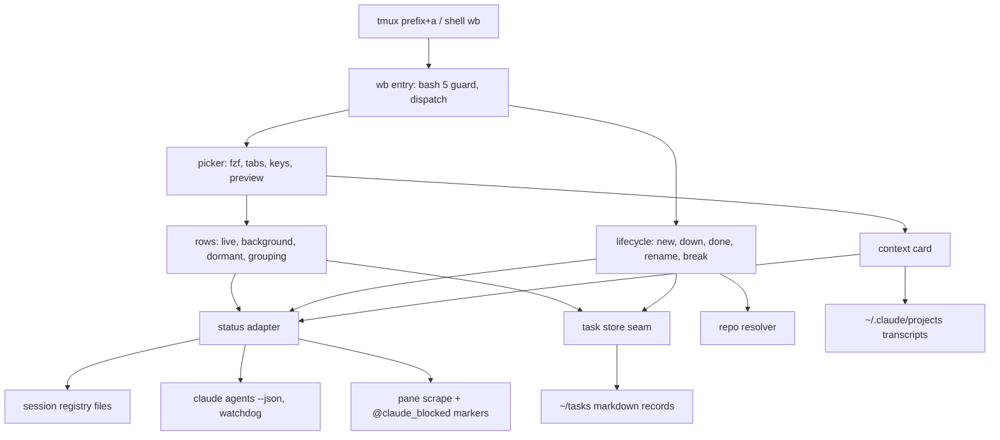
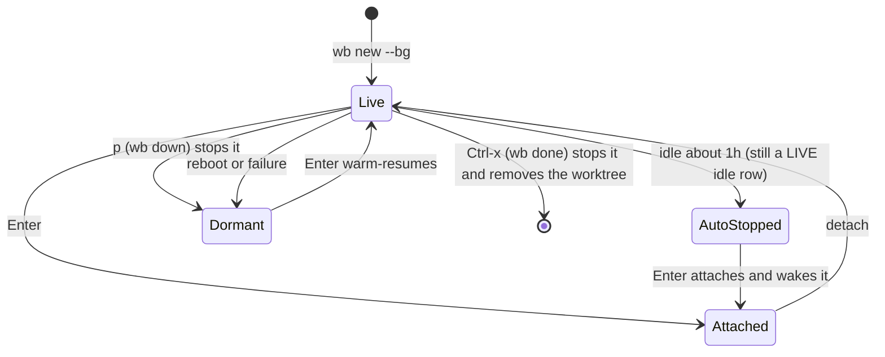

# Mac Picker With Native Status - Plan

## Goal Capsule

- **Objective:** On the Mac, Jet can see every Claude agent and task in one place, tell which ones need them, and jump to, start, resume or close any of them from the keyboard. Each place where the Mac build does something differently from wb ends with a written verdict the later dotfiles migration can use.
- **Means:** Carve the wb picker and `wb new` out of the work dotfiles repo into this repo as a Mac-first module, with status from Claude Code's session registry first and pane scraping as the fallback (KTD2, KTD3).
- **Product authority:** Jet. This plan covers only the Mac picker. Automatic checkpoints, cross-session messaging and family coordinators, realms, and the full migration of the work repo are surrounding areas, not active scope. The wider direction is in `docs/roadmap.md`.
- **Open blockers:** None.
- **Stop conditions:** Stop and ask before any change to the Ubuntu machine or the work repo, before committing anything that fails the R17 boundary scan, or if Claude Code's session registry has gone away and neither fallback in KTD3 works.
- **Execution profile:** Bash 5 shell scripts, fzf and tmux, tested with throwaway tmux servers. The work is done on a feature branch in this repo and finished by Jet.

---

## Product Contract

### Summary

A picker and `wb new`, carved out of wb into the personal dotfiles and opened with `prefix+a` on the Mac. It matches the Ubuntu picker as reworked in late October 2026, and gets agent status from Claude Code's own session data. Background sessions show as rows, and `wb new --bg` can start one. The build is a test bed: each deliberate difference from wb is recorded with a verdict for the eventual single-repo migration.

### Problem Frame

On the Mac, `prefix+m` runs `session.sh`. It opens a folder as a tmux session and does nothing else. Nothing shows which agents are working, which are waiting on Jet, or which tasks are on hold, so finding out means cycling through sessions.

The Ubuntu work machine solves this with the wb picker, which Jet counts among wb's best features. The picker lives in the work-account repo, though. It depends on Linux-only and bash-4 features, and it works out agent status by reading pane titles and screen text, a method its own code says needs recalibrating whenever Claude Code's UI changes. Claude Code now keeps a session registry on disk, one file per running session, including the tmux pane it runs in and its status. It can also run sessions in the background, where today's picker can't see them.

The long-term direction is to merge both machines into one dotfiles repo in a later full migration. Until then, the Mac is where alternatives to parts of wb can be tried without disturbing the setup Jet depends on at work.

Product Contract preservation: changed R2, R3, R4 and R12. R2 and R3 now track the picker as reworked in the work repo between 2026-10-25 and 2026-10-27: grouping, colour status, AGE, pinned family, `u`, context card. Jet asked for the plan to follow that rework. R4 now names Claude Code's session data rather than the `claude agents` command (KTD3). R12's folder case was corrected to `~/Desktop/Projects`.

---

### Key Decisions

- **The picker's code lives in the personal repo from now on.** Code moves from the work-account repo once, through review. (session-settled: user-directed — chosen over keeping two copies or rewriting from scratch: it starts the eventual single repo and crosses the boundary once.) Governs R17.
- **Mac first; the build is a test bed for the later migration.** It doesn't need to run on Ubuntu or carry a work overlay. (session-settled: user-directed — chosen over "Mac first, Ubuntu switches next": the full migration of the work repo comes later and will choose per area.) Governs R16.
- **Carve out the picker rather than lift and shift wb.** Only what the picker and `wb new` need comes over. Board, capture, weekly review and the ticket-link flag stay in the work repo. (session-settled: user-directed — chosen over copying `wb.sh` and `lib.sh` whole: smaller boundary review, and it follows the Go store plan's "delete before building".) Governs R16, R17.
- **`prefix+a` opens the picker; `prefix+m` stays as `session.sh`.** (session-settled: user-directed — chosen over folding folder-opening into the picker or dropping it: Jet keeps both jobs on separate keys.) Governs R1.
- **Native status underneath the picker, not agent view in its place.** The picker stays the UI; Claude's own session data is its status source. (session-settled: user-approved — chosen over replacing the picker with `claude agents` or running both side by side: agent view has no task rows, families, DORMANT or tmux jump.) Governs R4, R5, R6.
- **Port the picker as bash now; the Go store comes later.** Task reads and writes go through one seam the Go store can replace. (session-settled: user-directed — chosen over building the Go store first: a working Mac picker sooner, with nothing built twice.) Governs R14.
- **The whole picker comes over, not a minimum, and it follows the latest rework.** LIVE, DORMANT, warm resume, families, every session key and the late-October layout are in the first port. (session-settled: user-directed — chosen over a smaller first cut, and over porting the pre-rework picker.) Governs R2, R3, R15.
- **Sessions outside tmux are left off the picker unless they run in the background.** Plain-terminal and desktop-app sessions would bring back the many stale idle entries. (session-settled: user-approved — proposed in the scoping synthesis and confirmed.) Governs R7.
- **Parking a task stops its background agent.** `wb down` (`p`) means parked for foreground and background alike. (session-settled: user-directed — chosen over leaving the background agent running: one rule, and the task resumes warm from DORMANT.) Governs R18.

---

### Requirements

**Opening and layout**

- R1. On the Mac, `prefix+a` opens the picker and `prefix+m` keeps opening `session.sh`.
- R2. The picker matches the reworked Ubuntu picker's layout:
  - LIVE and DORMANT tabs, with LIVE refreshing about every 3 seconds.
  - Rows grouped by repo, with groups and rows in last-visit order, and each repo name printed once per group (every row shows it in search mode).
  - The current session's family pinned at the top, with the own row tagged `(here)`.
  - Four columns: REPO, NAME, BRANCH, AGE.
  - Status shown as the colour of REPO and NAME, with a one-line legend in the header.
  - Family nesting connectors.
  - A preview showing the session's context card, falling back to the pane bottom, a task summary or `git status`.
- R3. The picker keeps the Ubuntu picker's keys and their meanings:
  - `j`/`k`/`g`/`G` to move, and `Enter`/`l` to jump or resume.
  - `u` for the next row that needs Jet.
  - `n` new, `p` wb down, `r` rename, `b` break pane out, `Ctrl-x` wb done.
  - `Ctrl-r` refresh, `tab` switch tabs, `/` or `i` search, `q`/`h` close.

  The cursor opens on the first row that needs Jet, and the header counts them.

**Status**

- R4. Agent status comes from Claude Code's own session data first, mapped onto wb's statuses: needs you, finished, done, working, idle, dormant.
- R5. When that data is missing, fails or can't be parsed, status falls back to pane-based detection and the picker keeps working.
- R6. "Finished" and "blocked on an nvim decision buffer" keep coming from wb's own markers, because Claude's session data doesn't report them.
- R7. A Claude session appears on the picker when it runs in a tmux pane or in the background, attached to its task or family row when one matches. Other sessions don't appear.
- R8. `Enter` on a background session's row opens a tmux window attached to that session.
- R9. A tmux status segment shows how many agents need Jet, from the same status data.

**Starting and stopping work**

- R10. `wb new`, from the picker (`n`) or a shell, creates a worktree at `<repo>/.worktrees/<slug>`, a tmux session `<repo>--<slug>` with wb's window layout, and a task record linked to the session. Two writers must not be able to corrupt one task record.
- R11. `wb new --bg` does the same but starts the agent as a background session in that worktree, and the session shows up as a row.
- R12. Repos are found in the places `session.sh` searches: `~/dotfiles` and the git repos under `~/Desktop`, including `~/Desktop/Projects`.
- R18. `wb down` on a task whose agent runs in the background stops that agent along with the tmux session.

**Task store**

- R13. The Mac has a local personal task store at `~/tasks`, with no remote or sync. It uses the Ubuntu store's file format, so records can move across at migration.
- R14. Every task read and write goes through one seam that the planned Go store can replace without changing the picker.
- R15. DORMANT rows are rebuilt from task files. `Enter` on one rebuilds the session with a warm `claude --resume` typed in, for the conversation that was live last.

**Test bed and boundary**

- R16. Each deliberate difference from wb has a short written comparison in this repo: what differs, what to watch, and a keep-or-drop verdict once there is enough use. The differences are native status, background rows and `--bg`, the carved-out module, the store seam, and the repo resolver.
- R17. No employer-specific content lands in this repo: no employer or client names, repo names, ticket links, tokens or work paths. Code copied from the work-account repo is reviewed for this before it lands.

---

### Acceptance Examples

- AE1. **Covers R4.** **Given** an agent in a tmux pane is waiting on a permission prompt, **when** the picker refreshes, **then** its row is bold magenta ("needs you"), based on Claude's session data and not on the pane text.
- AE2. **Covers R5.** **Given** the session registry is empty or unreadable and `claude agents --json --all` fails, **when** the picker opens, **then** rows still appear with colours from pane detection.
- AE3. **Covers R6.** **Given** an agent has an nvim decision buffer open, **when** the picker refreshes, **then** the row shows "needs you" even though Claude reports the session as idle.
- AE4. **Covers R7, R8, R11.** **Given** `wb new --bg fix-thing` was run in `~/dotfiles`, **when** the picker opens, **then** a background row appears for `dotfiles--fix-thing`, and `Enter` on it opens a tmux window attached to that session.
- AE5. **Covers R7.** **Given** a Claude session is running in the desktop app, **when** the picker opens, **then** it isn't listed.
- AE6. **Covers R15.** **Given** the Mac rebooted and a background session for a task stopped, **when** Jet opens DORMANT and presses `Enter` on the task, **then** the session is rebuilt with `claude --resume` typed in for that conversation.
- AE7. **Covers R18.** **Given** a task's agent runs in the background, **when** Jet presses `p` on its row, **then** the tmux session and the background agent both stop and the task appears on DORMANT.

---

### Success Criteria

- Jet uses `prefix+a` on the Mac day to day instead of cycling through sessions.
- The status the picker shows matches what the agent is actually doing. Specifically, idle panes never show as working, which is the failure that the static title glyph causes today.
- By the time of the full migration, every comparison under R16 has a verdict.

---

### Scope Boundaries

- Automatic checkpoints (hook-written draft handoffs). `/wb-save` and `/wb-resume` stay as they are.
- Cross-session messaging in place of send-keys handoffs, fan-out, and family coordinator sessions.
- Realms: choosing a store by git remote, the cross-realm write guard, and auditing this repo's history (for example the deleted `ms-clients.sh`).
- Board, capture, weekly review, `wb breakdown`, `wb family --reseed`, decision propagation, and the ticket-link flag on `wb new`.
- The reply log and the status-line cost cache. The context card comes over without the parts that need them (KTD8).
- Any change to the Ubuntu machine, its keybindings, or the work repo.
- Running on Ubuntu, and a work-only overlay.
- Phone or desktop notifications.
- The Go store itself.
- Considered and not built: a stale-lock reaper beyond what KTD4 needs, and caching the last good registry read across picker restarts. A single user's picker re-reads every 3 seconds anyway; revisit if the registry read is ever slow.

---

<!-- ce-section: work-relationships -->
### How This Work Fits Together

This plan covers the Mac picker. The breakdown below is the current understanding, not a committed roadmap; `docs/roadmap.md` holds the living version.

- Automatic checkpoints: depends on the Mac task store from R13 and the store seam from R14. It can proceed independently of the picker UI.
- Messaging and family coordinators: enabled by background rows (R7, R11) and the registry's messaging fields. Shares family nesting from R2. Still to decide whether it's tried on the Mac first.
- Realms: shares the boundary rule in R17. Most likely lands with the migration.
- Full migration into one dotfiles repo: depends on the R16 verdicts to choose per area between the Mac build and wb.
- Go store: replaces the seam in R14. Can proceed independently of this plan.

---

### Dependencies / Assumptions

- Claude Code writes a session registry at `~/.claude/sessions/<pid>.json` for each running session, with `sessionId`, `pid`, `procStart`, `status`, `statusUpdatedAt`, `cwd`, `kind`, `name` and, for sessions in tmux, `tmux` ending in the pane id (`2:@8.%8`). This is an internal file, not a documented interface, and wb already relies on it for the context card and `wb family --sessions`.
- `claude agents --json --all` lists sessions with `cwd`, `kind`, `name`, `pid`, `sessionId`, `startedAt`, `status`, and `waitingFor` only while waiting. It is a research preview.
- Background sessions stop on reboot, and idle unattached ones stop after about an hour, resuming when attached. A background session started inside a git worktree skips Claude's own worktree creation.
- In tmux, a Claude pane's `pane_current_command` is the Claude version string (for example `2.1.310`), not `claude`.

---

### Outstanding Questions

**Deferred to Implementation**

- Do background sessions appear in the registry, and with which `kind` and `tmux` values? This decides whether KTD3's `claude agents --json` step is needed for background rows.
- Do background sessions inherit `TMUX_PANE` from the pane that started them? If they do, the notify hook would mark the wrong pane; the hook then needs to check the registry before writing (U3).
- Which `status` values does the registry use beyond `busy`, `idle` and `waiting` (failed, stopped, completed)? Unknown values map to idle until seen.
- Does the registry ever report `waiting`? On 2026-10-27 the live files showed only `busy` and `idle`. If a permission prompt doesn't show as `waiting`, "needs you" (AE1) relies on the notify hook's `needs-input` marker, and AE1 changes to match.
- Does `claude --bg -n <name>` start without a prompt? If it needs one, `wb new --bg` supplies a short opening prompt and the U5 fakes change to match.
- Does `claude agents --json --all` stay well under its 2-second watchdog? If it often times out, it runs outside the 3-second LIVE refresh and its last result is reused.

---

## Planning Contract

### Key Technical Decisions

- KTD1. **Require Homebrew bash 5; don't rewrite for bash 3.2.** wb uses namerefs, `local -A` and `mapfile`, and empty-array expansion under `set -u` crashes on 3.2, so a 3.2 port would rewrite most reached functions. The entry point checks `BASH_VERSINFO` and exits with an install hint below 5 (4.4 is the floor for the empty-array fix; 5 is what gets installed and tested). `install.sh` installs `bash`. Scripts use `#!/usr/bin/env bash`, which resolves to Homebrew's bash because tmux runs commands through the login shell's `PATH`.
- KTD2. **Copy the reached functions from the work repo at `481d6ed` into new files, then fix them.** The research mapped the reached set to about 84 functions in `wb.sh` plus helpers in `lib.sh`, `wb-locks.sh` and `claude-card.sh`. Nothing sources `wb-board.sh`, `wb-lifecycle.sh`, `wb-capture.sh` or the full `wb-locks.sh`. Linux-only calls get shims that also run on Linux where that costs nothing. Instantiates the carve-out Key Decision. Governs R16, R17.
- KTD3. **Status source order: session registry, then `claude agents --json --all` for background sessions the registry can't place, then pane scraping.** The registry gives the pane id directly, costs only file reads, and is already what wb trusts for the card and family names. A registry entry counts only while its pid is alive with the same `procStart`. The registry stores `procStart` in UTC and C-locale form (`Sun Oct 25 17:48:10 2026`), so the check compares it against `TZ=UTC LC_ALL=C ps -o lstart= -p <pid>` through a compat helper; plain `ps` prints local time and never matches. `claude agents --json --all` runs at most once per refresh, under a 2-second watchdog. Pane scraping keys on the process tree, not `pane_current_command`, because of the version-string finding. Governs R4, R5, R7.
- KTD4. **Lock task records with `mkdir`, not `flock`.** `mkdir` is atomic on macOS and Linux. The lock directory holds the holder's pid, and a lock whose pid is dead is taken over. This keeps R10's two-writer protection without `flock`.
- KTD5. **Resolve repos by name across configured roots, and store the full path on the task.** Repos are found the way `session.sh` finds them: `~/dotfiles`, plus every repo a recursive `.git` search (pruned at each repo) finds under `~/Desktop`, which covers `~/Desktop/Projects` and repos nested below it. The search roots are overridable through `WB_REPO_ROOTS`. `wb new` writes a `repo_path:` frontmatter field. Readers use that field first, and fall back to the resolver for records that lack it, as Ubuntu records do. Two repos with the same basename are refused at `wb new` with both paths printed. Governs R12, R13.
- KTD6. **Background sessions are identified by session id.** `wb new --bg` starts `claude --bg -n <session-name>` in the worktree. That prints a short id, so `wb new` looks up the session's full `sessionId` UUID (matched on the short id or name) and records that in the task's `claude_sessions:` as `@primary`; the short id is used only for `claude attach` and `claude stop`. Rows are matched by session id, then by real-path `cwd` compared case-insensitively. Rows are deduplicated by session id, so an attached session shows once. `Enter` attaches by id in the agent window of the task's own `<repo>--<slug>` session, which `--bg` leaves empty, and jumps there when it is already attached. A background session with no task attaches in a new window of the current session. A session Claude auto-stopped after an hour of idling still shows as a LIVE idle row while it's listed; a failed or stopped one moves to DORMANT. `wb down` and `wb done` stop the background session by id before removing anything (R18). Governs R7, R8, R11, R18.
- KTD7. **Install the notify hook by merging it into `~/.claude/settings.json`.** `install.sh` adds the `UserPromptSubmit`, `Notification` and `Stop` entries with `jq` if they're missing and leaves every other setting alone. Stowing `settings.json` would replace Jet's existing settings. Governs R6.
- KTD8. **Port the context card in transcript-only form.** It keeps state from the registry, the latest recap, the last two prompts, the start of the last reply and open questions. Artifacts, decisions, model, cost and context % depend on the reply log and the status-line cache, so the card omits those lines when their sources are absent. Governs R2.
- KTD9. **Drop the out-of-scope reaches, don't stub them.** The status line loses its week and follow-up counts. `wb done` loses the capture call, the weekly-review nudge and the repo-name nudge, and skips the decision buffer when `open-buffer.sh` isn't installed. The PR check in `wb down` uses `gh` under the watchdog with no token fallback. The ticket-link flag and the board verbs aren't ported.
- KTD10. **Port the tests that cover the reached set, and add a runner.** Each test keeps wb's harness of a throwaway `tmux -L` server with fixture `CODE_DIR`, `TASKS_DIR` and `CLAUDE_PROJECTS_DIR`, plus a new fixture `CLAUDE_SESSIONS_DIR`. GNU `date -d` and `touch -d` in tests become portable helpers. A `run-tests.sh` runs every test file, because wb's only runner is a Linux Dockerfile.
- KTD11. **Warm resume uses the post-#116 ranking.** The resume id is `@primary` if its transcript exists. Otherwise it is the transcript with the newest activity-line timestamp in its last 256 KiB, falling back to mtime. Governs R15.

### High-Level Technical Design

The module is a set of sourced libraries behind one entry point. The picker, `wb new` and the lifecycle verbs call the store and status layers, never the files underneath them.



Status for one pane is decided in this order:

```mermaid
flowchart TB
  A[pane has a live registry entry?] -->|yes| B[@claude_blocked set?]
  A -->|no| D[claude agents --json entry for its pid?]
  D -->|yes| B
  D -->|no| G[process-tree + screen scan fallback]
  G --> B
  B -->|nvim-buffer or needs-input| N[needs you]
  B -->|done| F[finished]
  B -->|unset| M[map registry status: waiting to needs you, busy to working, idle to idle, unknown to idle]
```

A background session's row moves between states like this:



### Output Structure

```text
scripts/.config/scripts/tmux/
  wb                      entry point, bash 5 guard, verb dispatch
  wb-lib/
    compat.sh             lock, date, stat, watchdog shims
    repos.sh              repo resolver
    store.sh              task store seam, template seeding, resume id
    status.sh             registry, claude agents, pane fallback
    rows.sh               live, background and dormant rows; grouping
    picker.sh             fzf picker, keys, preview command
    lifecycle.sh          new, down, done, rename, break
    card.sh               context card
    TEMPLATE.md           employer-free task template
  claude-notify-hook.sh
  claude-status.sh
  tests/
    run-tests.sh
    fixtures/
    *.test.sh
docs/wb-mac/comparisons.md
```

### Implementation Constraints

- Every file copied from the work repo is scanned for employer content before it is committed (R17). The scan covers org and client names, repo names, ticket URLs, token handling and `~/code` paths.
- Nothing writes outside `~/tasks`, the repo's own worktrees, tmux options and the merged hook entries.

### Sequencing

U1 first, because every other unit needs bash 5, the shims and the test harness. U2 and U3 can proceed in parallel. U4 and U5 need both. U6 needs U3. U7 wires everything up after U4 and U5, and U8 closes out.

---

## Implementation Units

### U1. Foundation: bash 5 guard, compat shims, repo resolver, test harness

**Goal:** A Mac with stock tools can run the module, and its tests can run.

**Requirements:** R10 (lock), R12; KTD1, KTD4, KTD5, KTD10.

**Dependencies:** None.

**Files:**
- `install.sh`
- `scripts/.config/scripts/tmux/wb`
- `scripts/.config/scripts/tmux/wb-lib/compat.sh`
- `scripts/.config/scripts/tmux/wb-lib/repos.sh`
- `scripts/.config/scripts/tmux/tests/run-tests.sh`
- `scripts/.config/scripts/tmux/tests/compat.test.sh`
- `scripts/.config/scripts/tmux/tests/repos.test.sh`

**Approach:**
1. Make `install.sh` install `bash`, `fzf`, `fd` and `jq` if missing, and add `claude` to its hand-step checks.
2. The `wb` entry checks the bash version, sources `wb-lib/*.sh` and dispatches verbs. It has no board or capture verbs.
3. `compat.sh` provides:
   - the `mkdir` lock with dead-pid takeover (KTD4);
   - a process-start helper in the registry's `procStart` form (KTD3);
   - epoch-to-date and file-mtime helpers that try BSD forms, then GNU;
   - a `perl` alarm watchdog in place of `timeout`;
   - a field splitter that keeps empty fields.
4. `repos.sh` resolves a repo name to a path across `WB_REPO_ROOTS` and refuses ambiguous names (KTD5).
5. `run-tests.sh` runs every `*.test.sh` and prints a pass/fail summary.

**Patterns to follow:** the work repo's `wb-locks.sh` lock semantics and `tests/wb-new.test.sh` harness (throwaway `tmux -L` socket, fixture dirs).

**Test scenarios:**
- Running `wb` under `/bin/bash` 3.2 exits non-zero with a message naming `brew install bash`.
- Two processes take the same task lock: the second waits, then gets it after the first releases.
- A lock directory holding a dead pid is taken over immediately.
- The watchdog kills a command that sleeps past the limit and returns non-zero, while a fast command's output and exit code pass through.
- The epoch-to-date and mtime helpers give the same results as the GNU forms for fixed inputs.
- The resolver finds `dotfiles` under `~/dotfiles`, a fixture repo under `Desktop/Projects` and one nested two levels below it (fixture roots), returns nothing for an unknown name, and errors listing both paths when two roots hold the same name.
- The field splitter keeps empty middle fields.

**Verification:** `run-tests.sh` passes on the Mac, and `install.sh` stays idempotent.

### U2. Task store seam and template

**Goal:** Every task read and write in the module goes through one store layer backed by `~/tasks`.

**Requirements:** R13, R14, R15 (resume id); KTD5, KTD11.

**Dependencies:** U1.

**Files:**
- `scripts/.config/scripts/tmux/wb-lib/store.sh`
- `scripts/.config/scripts/tmux/wb-lib/TEMPLATE.md`
- `scripts/.config/scripts/tmux/tests/store.test.sh`
- `scripts/.config/scripts/tmux/tests/resume-id.test.sh`

**Approach:**
- Port the work repo's task-file helpers that the reached set uses: path, seed, frontmatter get and set, append to Handoffs, family stems and tree, and transcript listing. All of them sit behind store functions named for what they do, not for the file layout.
- `TEMPLATE.md` follows the schema in the work repo's `docs/wb-guide.md` (task file format) and adds `repo_path:`. No employer fields.
- On first use, `~/tasks` is created and the template is copied in.
- The resume id follows KTD11.

**Patterns to follow:** the work repo's `wb_seed_task`, `wb_task_file`, `_wb_family_tree` and `wb_resume_id` (post-#116).

**Test scenarios:**
- Seeding a task in an empty fixture store creates the store, the template and `<repo>--<slug>.md`, with `repo_path:` set and status `doing`.
- Seeding a slug that already exists returns the existing file unchanged.
- Setting a frontmatter field leaves the other fields and every section unchanged.
- A family tree with a cycle stops at the repeated stem.
- Resume id: `@primary` wins when its transcript exists.
- Resume id: with `@primary` missing, the transcript with the newest activity line wins even when another transcript has a newer mtime, the case where shutdown bookkeeping leaves the files tied.
- Resume id: with no activity lines, mtime decides.
- A record without `repo_path:` resolves its repo through U1's resolver.

**Verification:** All store tests pass, and nothing outside `store.sh` touches task files directly. Check by grepping for the store path in other `wb-lib` files.

### U3. Status adapter and notify hook

**Goal:** Each Claude pane and background session gets a status from Claude's own data, with markers and fallbacks.

**Requirements:** R4, R5, R6, R7 (matching), R9 (data); KTD3, KTD6, KTD7; AE1, AE2, AE3.

**Dependencies:** U1.

**Files:**
- `scripts/.config/scripts/tmux/wb-lib/status.sh`
- `scripts/.config/scripts/tmux/claude-notify-hook.sh`
- `install.sh`
- `scripts/.config/scripts/tmux/tests/status.test.sh`
- `scripts/.config/scripts/tmux/tests/claude-notify-hook.test.sh`
- `scripts/.config/scripts/tmux/tests/fixtures/sessions/`
- `scripts/.config/scripts/tmux/tests/fixtures/claude-agents.json`

**Approach:**
1. Read every registry file once per refresh. Skip unreadable or half-written files. Keep only entries whose pid is alive with a matching `procStart`.
2. Join panes on the `tmux` field's pane id.
3. For background sessions the registry can't place, call `claude agents --json --all` under the watchdog, at most once per refresh. Build this step, its fixture and its hang test only if the probe shows the registry can't place background sessions; otherwise drop it and note it in the comparisons doc as considered and not built.
4. Apply the `@claude_blocked` markers over the registry status, as in the second diagram.
5. The pane-scrape fallback is the work repo's `tmux_claude_panes`, with detection moved from `pane_current_command` to the process tree.
6. Port `claude-notify-hook.sh` as is if the probe shows background sessions don't inherit `TMUX_PANE`. If they do, the hook checks the registry before writing pane options.
7. `install.sh` merges the hook entries into `~/.claude/settings.json` with `jq` (KTD7).

**Execution note:** First probe what the registry holds for a `claude --bg` session, and whether a background session sees `TMUX_PANE`. Settle the deferred questions (background sessions in the registry, `TMUX_PANE`, `waiting`, starting `--bg` without a prompt) before writing steps 3 and 6, check how the short id `claude --bg` prints relates to the registry's `sessionId`, and record what was found in `docs/wb-mac/comparisons.md`.

**Patterns to follow:** the work repo's `claude-card.sh` `registry_entry`, `wb.sh` `_wb_registry_panes`, and `lib.sh` `tmux_claude_panes`.

**Test scenarios:**
- Covers AE1. A fixture registry entry with status `waiting` and a pane id gives that pane "needs you".
- Registry `busy` maps to working, and `idle` to idle.
- An unknown status maps to idle.
- An entry whose pid is dead is ignored.
- An entry whose pid is alive but whose `procStart` differs (pid reused) is ignored.
- An entry with a hard-coded `procStart` in the registry's real format (`Sun Oct 25 17:48:10 2026`) is accepted for a live pid started at that UTC time.
- A half-written registry file is skipped, and the entries after it still load.
- Covers AE3. `@claude_blocked=nvim-buffer` on a pane whose registry status is `idle` gives "needs you".
- `@claude_blocked=done` gives "finished".
- Covers AE2. With no registry directory and a fixture `claude` that exits non-zero, a fixture pane running a fake claude child gives a status from the fallback.
- A `claude agents` fixture that hangs is cut off by the watchdog, and the refresh still returns rows.
- A background session present only in `claude agents --json --all` comes back as a background entry with its session id and `cwd`.
- Notify hook: `start` sets `@claude_working`, `needs-input` sets `@claude_blocked`, and `done` after 30 seconds sets `done`.
- Hook merge: running the `install.sh` merge twice on a settings fixture that has other keys adds the entries once and keeps the other keys.

**Verification:** Status tests pass. On the live Mac, at least one live registry entry passes the `procStart` check, and the picker's statuses match `claude agents --json --all` for every running session.

### U4. Rows and the picker

**Goal:** `wb` opens the reworked picker over live, background and dormant rows.

**Requirements:** R2, R3, R7, R8 (row side); KTD6, KTD9; AE4, AE5.

**Dependencies:** U2, U3.

**Files:**
- `scripts/.config/scripts/tmux/wb-lib/rows.sh`
- `scripts/.config/scripts/tmux/wb-lib/picker.sh`
- `scripts/.config/scripts/tmux/tests/picker-rows.test.sh`
- `scripts/.config/scripts/tmux/tests/picker-grouping.test.sh`

**Approach:**
- Port `collect_live_rows`, `render_rows`, the dormant collector, the grouping and ordering, the character-safe `pad`/`padtail` under `LC_ALL=C` awk, the colour legend, the pinned family, and `picker()` with its fzf bindings from the work repo at `481d6ed`.
- Background sessions become rows nested under their task or family, matched per KTD6. A background row carries a `(bg)` tag after NAME. One that matches no task or family renders as its own row in its cwd repo's group.
- On a background row, `b` shows "no pane to break out" and does nothing, and `r` renames the task.
- Rows are deduplicated by session id.
- A task counts as DORMANT only when no live or background entry has its worktree as `cwd`.
- The header's pending counts drop the week and follow-up parts (KTD9).

**Patterns to follow:** the work repo's `wb.sh` `collect_live_rows`, `render_rows`, `picker`, `wb_preview_cmd` and tests `wb-picker-rows.test.sh` and `wb-picker-grouping.test.sh`.

**Test scenarios:**
- Rows from two repos group by repo in last-visit order, and the repo name prints once per group but on every row in search mode.
- The current session's family sits at the top with `(here)` and a separator row that keys ignore.
- A status change between two refreshes changes a row's colour without moving it.
- Covers AE4. A fixture background session with the session id recorded on `dotfiles--fix-thing` renders nested under that task.
- The same background session attached in a tmux pane renders once.
- A background session matching no task renders as a `(bg)` row in its cwd repo's group.
- `b` on a background row prints the no-pane message and changes nothing; `r` renames its task.
- Covers AE5. A registry entry with no `tmux` field and `kind` interactive (a desktop-app session) renders no row.
- A task whose worktree has a live background session doesn't appear on DORMANT.
- A task with status `doing` and a transcript but no live session appears on DORMANT with the transcript's age.
- A name containing multi-byte characters pads to the column without being cut mid-character.
- The cursor opens on the first needs-you row, `u` wraps to the next, and the own row never counts.

**Verification:** Picker tests pass. Opening `wb` on the Mac shows every running session in its repo group with the right colour.

### U5. Lifecycle verbs

**Goal:** `wb new` (with `--bg`), `wb down`, `wb done`, rename, break-out, background attach and DORMANT resume work on the Mac.

**Requirements:** R8, R10, R11, R15, R18; KTD5, KTD6, KTD9; AE4, AE6, AE7.

**Dependencies:** U2, U3.

**Files:**
- `scripts/.config/scripts/tmux/wb-lib/lifecycle.sh`
- `scripts/.config/scripts/tmux/tests/wb-new.test.sh`
- `scripts/.config/scripts/tmux/tests/wb-down.test.sh`
- `scripts/.config/scripts/tmux/tests/wb-done.test.sh`
- `scripts/.config/scripts/tmux/tests/wb-resume.test.sh`

**Approach:**
- Port `cmd_new` and its worktree, bootstrap, layout and seed helpers, plus `cmd_down`, `cmd_done`, rename and break-out from the work repo at `481d6ed`.
- Take out the ticket-link flag, the capture and nudge calls, and the token fallback (KTD9).
- `wb new` resolves the repo through U1, writes `repo_path:` and takes the U1 lock around the task write.
- `--bg` follows KTD6.
- `wb down` and `wb done` stop the background session first.
- `wb done` skips the decision buffer when its script is absent.
- `Enter` on a background row opens or jumps to an attach window.

**Patterns to follow:** the work repo's `tests/wb-new.test.sh`, `wb-down.test.sh`, `wb-done.test.sh` and `wb-resume.test.sh`.

**Test scenarios:**
- `wb new dotfiles fix-thing` creates `.worktrees/fix-thing`, the session `dotfiles--fix-thing` with nvim, agent and shell windows, and a task with `repo_path:`, and sets `@task` on the session.
- `wb new` run inside a repo with only a slug takes the repo from the git root.
- `wb new` for an ambiguous repo name fails, names both paths and creates nothing.
- Two `wb new` runs racing on the same slug produce one worktree and one intact task file.
- Covers AE4. `wb new --bg` with a fake `claude` that prints a short id records the matching full session UUID as `@primary`, and starts no agent in the agent window.
- Covers AE7. `wb down` on a `--bg` task calls the fake `claude stop` with the recorded id, kills the tmux session, keeps the worktree, and the task appears on DORMANT.
- `wb done` on a `--bg` task stops the session before removing the worktree.
- `wb done` with no decision-buffer script completes and removes the worktree.
- Covers AE6. Resuming a DORMANT task rebuilds the session and types, but doesn't run, `claude --resume <id>` in the agent window.
- `Enter` twice on the same background row attaches in the task session's agent window and then jumps to it.
- `wb down` with `gh` hanging still finishes, through the watchdog, and leaves status unchanged.

**Verification:** Lifecycle tests pass. A real `wb new --bg` on the Mac shows up in the picker, attaches, parks with `p`, and resumes from DORMANT.

### U6. Context card

**Goal:** The picker preview shows the transcript-only context card for rows with a Claude session.

**Requirements:** R2 (preview); KTD8.

**Dependencies:** U3.

**Files:**
- `scripts/.config/scripts/tmux/wb-lib/card.sh`
- `scripts/.config/scripts/tmux/tests/card.test.sh`

**Approach:**
- Port `claude-card.sh` keeping state, recap, last prompts, last reply start and open questions.
- Lines whose source files are absent are omitted silently.
- Replace `tac` with a portable reverse read.
- Input that names no session and no history prints nothing, so the preview falls back.

**Patterns to follow:** the work repo's `claude-card.sh` and `tests/claude-card.test.sh`.

**Test scenarios:**
- A fixture transcript with an `away_summary` and two prompts prints the state, the recap and both prompts.
- A turn started after the recap hides the recap.
- A reply with a "Needs you" section lists those items as open questions.
- No reply log and no status cache: the card prints without artifact, decision or cost lines and without errors.
- A pane with no Claude prints nothing and exits non-zero, so the preview falls back to the pane bottom.

**Verification:** Card tests pass. The preview shows the card for a live Claude pane on the Mac.

### U7. tmux wiring and status segment

**Goal:** `prefix+a` opens the picker and the status bar counts agents needing Jet.

**Requirements:** R1, R9.

**Dependencies:** U4, U5.

**Files:**
- `tmux/.config/tmux/tmux.conf`
- `zsh/.zshrc`
- `scripts/.config/scripts/tmux/claude-status.sh`
- `scripts/.config/scripts/tmux/tests/claude-status.test.sh`

**Approach:**
- Bind `a` to open `wb` in a new window with `$HOME` as its cwd, as Ubuntu does. Leave `m` on `session.sh`.
- Point `status-left` at `claude-status.sh` and widen `status-left-length` enough for the counts. Put both lines after the `run '~/.config/tmux/plugins/tpm/tpm'` line: catppuccin-tmux resets `status-left`, `status-right` and their lengths when it loads, which already overrides the current `status-right` setting.
- `claude-status.sh` counts needs-you and finished panes from U3's status data.
- Add a `wb` alias to `zsh/.zshrc` beside the `s` and `N` aliases, so `wb new` works from a shell (R10).

**Patterns to follow:** the work repo's `tmux.conf` picker bindings and `claude-status.sh`.

**Test scenarios:**
- With one pane needing Jet and one finished, `claude-status.sh` prints both counts.
- With none, it prints nothing.

**Verification:** After `prefix+r`, `prefix+a` opens the picker, `prefix+m` still opens `session.sh`, and `tmux show -g status-left` still names `claude-status.sh`. `wb` runs from a new shell.

### U8. Comparisons and boundary check

**Goal:** Each alternative under test is written up, and the branch passes the employer-content scan.

**Requirements:** R16, R17.

**Dependencies:** U1–U7.

**Files:**
- `docs/wb-mac/comparisons.md`
- `docs/roadmap.md`

**Approach:**
- One short section per difference named in R16: what differs from wb, what to watch, and a verdict line left as "open" until there is enough use. The U3 probe findings go here too.
- Update the roadmap's status line for this piece.
- Run the R17 scan over every file the branch adds.

**Test expectation:** none -- documentation and a review pass.

**Verification:** The comparisons doc names every R16 difference, and the scan finds nothing.

---

## Verification Contract

| Check | Proves | Applies to |
|---|---|---|
| `scripts/.config/scripts/tmux/tests/run-tests.sh` passes on the Mac under Homebrew bash | Unit behaviour for compat, store, status, rows, lifecycle, card and status segment | U1–U7 |
| `install.sh` runs twice cleanly; `~/.claude/settings.json` keeps its other keys and has the hook entries once | Idempotent setup and the hook merge | U1, U3 |
| Manual: `prefix+a` on the Mac lists every running Claude session with the right colour, compared against `claude agents --json --all` | R4 and success criterion 2 on real data | U3, U4 |
| Manual: `wb new --bg`, attach, `p`, DORMANT `Enter` on a real repo | AE4, AE6, AE7 end to end | U5 |
| A case-insensitive grep over the branch's added files for employer, client and work-repo names, ticket URLs, token handling and `~/code` paths finds nothing | R17 | U8 |

---

## Definition of Done

- Every unit's verification holds, and `run-tests.sh` passes.
- `prefix+a` opens the picker on the Mac, and `prefix+m` still opens `session.sh`.
- `docs/wb-mac/comparisons.md` covers every R16 difference, with the U3 probe findings recorded.
- The R17 scan over the branch is clean.
- No code from abandoned approaches is left in the diff, and nothing under `wb-lib/` is unused.
- The plan's deferred questions are answered in the comparisons doc or carried into `docs/roadmap.md`.

---

## Sources / Research

- `docs/brainstorms/2026-10-25-sessions-and-tasks-current-state.md`: current wb design and its gaps.
- `docs/ideation/2026-10-25-parallel-sessions-and-tasks-ideation.html`: the ranked directions this plan draws on.
- `reports/AI agent workflow alternatives.md` and `research_notes/AI agent workflow alternatives/claude_code_native.md`: agent view, `--bg`, `attach` and their limits.
- `docs/plans/2026-10-18-1641-feat-mac-starting-state-plan.md`: the deferred status-left segment and agent binds.
- `docs/roadmap.md`: the direction this plan is one piece of.
- `tmux/.config/tmux/tmux.conf` and `scripts/.config/scripts/tmux/session.sh`: the current Mac binding and folder opener.
- Work dotfiles repo at `481d6ed`, used as a read-only reference and not copied here wholesale:
  - `scripts/.config/scripts/tmux/wb.sh`: `picker`, `collect_live_rows`, `render_rows`, `wb_preview_cmd`, `cmd_new`, `cmd_down`, `cmd_done`, `wb_seed_task`, `wb_resume_id`, `_wb_registry_panes`, `_wb_family_tree`.
  - `lib.sh` (`tmux_claude_panes`), `wb-locks.sh`, `claude-card.sh`, `claude-notify-hook.sh`, `claude-status.sh`.
  - `docs/wb-guide.md`: "The picker" and the task file format.
  - The picker rework plans and PRs #116, #120, #121, #124 and #125.
- Measured on this Mac (2026-10-26):
  - bash is 3.2 and there is no Homebrew bash.
  - `flock`, `timeout` and GNU `date` are missing.
  - fzf 0.61.3, fd 10.2, jq 1.7.1 and tmux 3.5a are installed.
  - For all 9 live sessions, the Claude pid's parent was the pane's shell.
  - `pane_current_command` shows the Claude version string.
  - The registry files carry a `tmux` pane id.
