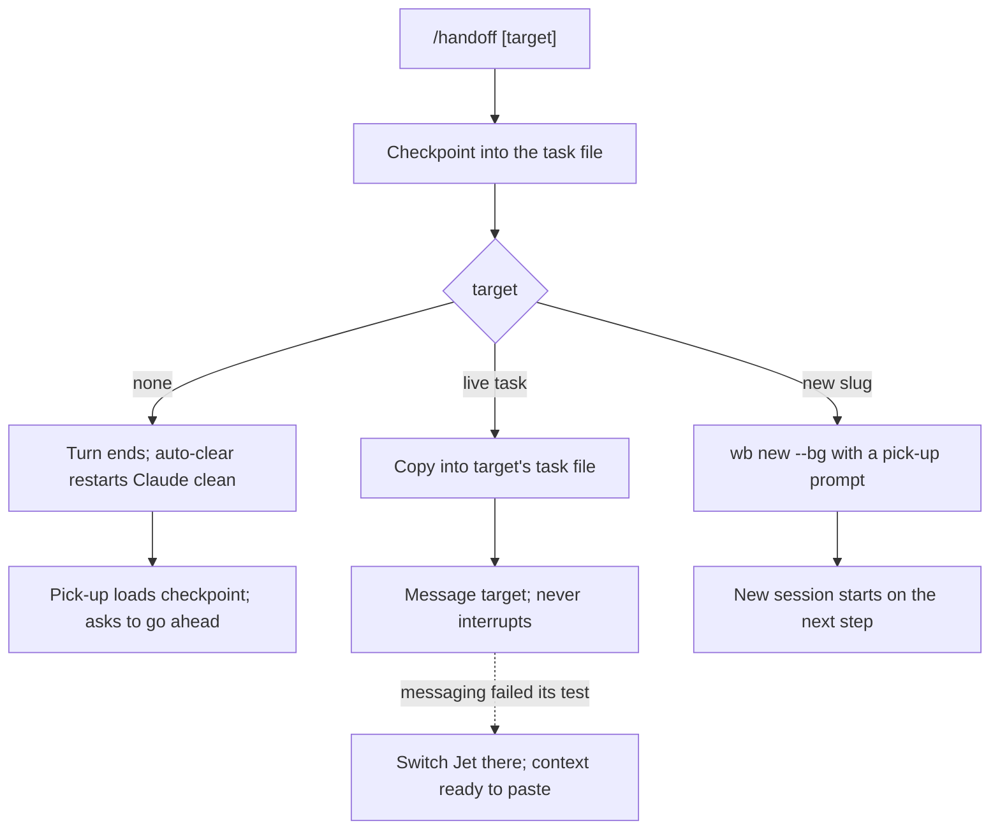
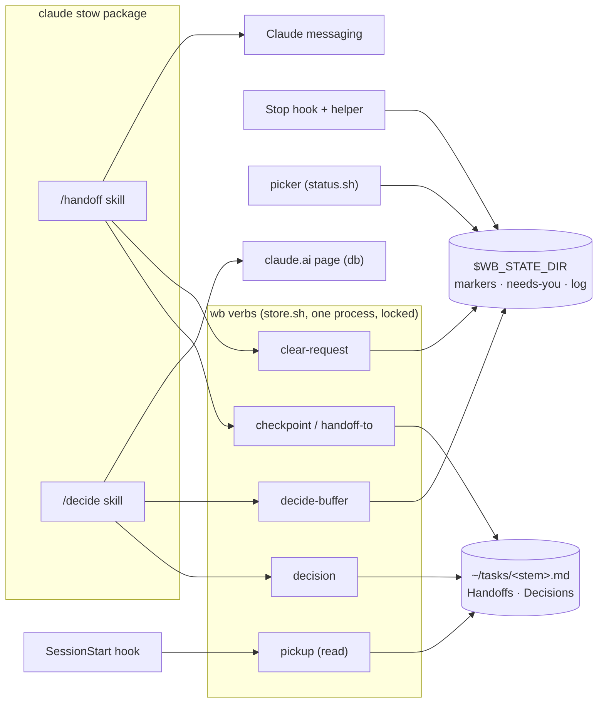
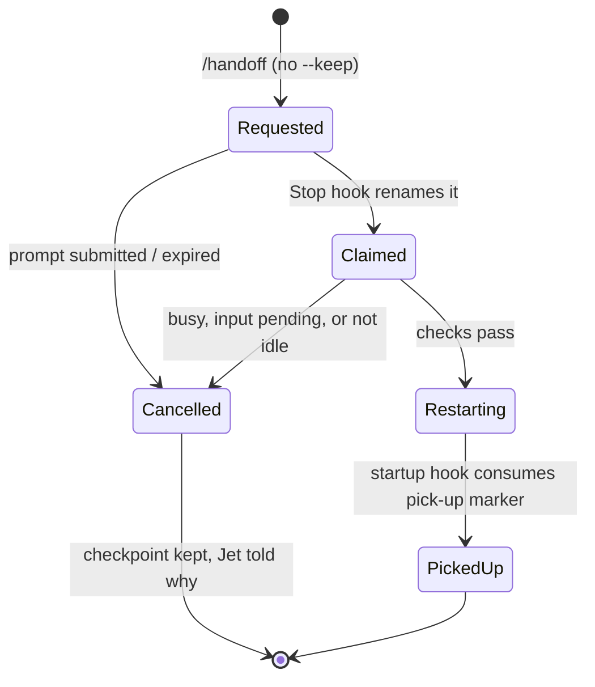

# Mac wb handoff and decide - Plan

## Goal Capsule

- **Objective:** On the Mac, Jet can checkpoint and carry on in a clean context, pass work to another session, and answer batches of decisions with no more effort than on the work machine, and in most cases less.
- **Means:** Two skills, `/handoff` and `/decide`, built on the `~/tasks` store from `feat/mac-picker-native-status`, plus Claude Code hooks, cross-session messaging and claude.ai artifact pages (KTD1–KTD13). They replace the work machine's `/wb-save`, `/wb-resume`, `/handoff`, `/decision-buffer`, `/decision-page` and `/review-page`.
- **Product authority:** Jet. The Product Contract wins on behaviour; KTDs win on mechanism within it. The work machine's versions of those six skills set the minimum bar: each new loop must be at least as simple, intuitive and useful.
- **Stop conditions:**
  - A test run (U3, U5, U6) shows a settled mechanism can't work: stop that unit, take its recorded fallback, and tell Jet.
  - Any step would need committing the uncommitted `tmux.conf` lines, nvim edits, the `ms-clients.sh` deletion, or untracked `reports/`, `research_notes/` or convergence-findings files: stop.
- **Execution profile:** local, path-limited commits on `feat/mac-picker-native-status`. No push and no PR unless Jet asks. Tests run only on a private tmux socket, never the real server.
- **Open blockers:** none.

---

## Product Contract

Product Contract preservation: changed R3 and R8. Both were reworded to match documented Claude Code behaviour, as confirmed with Jet in the planning synthesis. R3 also now names same-task pick-ups only, so it no longer overlaps R10. Outstanding Questions were resolved in place, and the remainder moved to Open Questions.

### Summary

`/handoff` writes a checkpoint to the task file and sends it to one of three places. With no target it goes back to this session, which restarts itself in a clean context and picks the work up after you confirm. It can also go to a live task by cross-session messaging, or to a new task started with `wb new --bg`. `/decide` asks a batch of questions on the surface that fits: an nvim buffer, a private claude.ai page, or both. Answers are recorded in the task's Decisions section.

### Problem Frame

Jet's four most-used loops on the work machine are `/wb-resume` (91 uses from 1 Jul to 22 Sep 2026), `/wb-save` (86), `/decision-buffer` (56) and `/handoff` (27). The Mac has none of them. The picker and task store are now built there, but work started on the Mac can't be checkpointed, handed on, or put to Jet as a batch of decisions.

The work versions also carry friction:
- **Save and resume:** a three-step ritual around a manual `/clear`. Jet built it before knowing how compaction behaves, and values it as a "self handoff" that marks a checkpoint and queues the next item in a clean context.
- **Clearing:** having the agent clear itself was tried and blocked by Claude Code's auto mode, because the agent typed `/clear` into its own tmux pane.
- **Live handoff:** relies on typing into tmux panes and a Linux clipboard tool.
- **Decisions:** spread across three skills with routing tables that point at each other. The decision buffer's own notes record choosing the wrong tool more than once.
- **Answering pages:** answers come back by pasting a block, or through a local server, so Jet has to be at the machine.

### Key Decisions

- **Rebuild the loops rather than port the skills.** (session-settled: user-directed — chosen over copying the work skills as they are: Claude Code and the workflow have moved on, and the current versions serve as the minimum bar instead.) Governs R1–R23.
- **One `/handoff` verb with three destinations replaces save, resume and handoff.** (session-settled: user-approved — chosen over keeping `/wb-save`, `/wb-resume` and `/handoff` as separate commands that share a format: Jet experiences save/resume as handing off to yourself.) Governs R1, R7, R10.
- **Pick-up after a clear is automatic, then confirms.** (session-settled: user-directed — chosen over continuing without asking and over loading only when asked: it keeps resume's safety check with nothing to type.) Governs R3, R4.
- **A hook Jet installs clears the session, not the agent.** (session-settled: user-directed — chosen over a one-key tmux binding and over a manual `/clear`: auto-clearing is a large upgrade, and a user-installed hook expresses Jet's standing choice where an agent clearing itself was blocked.) Governs R2, R5, R22.
- **Live handoffs use Claude Code's cross-session messaging, proved by a test run first.** (session-settled: user-directed — chosen over typing into the target's tmux pane: Jet agreed to try it if it's recommended and safe, provided the plan confirms it behaves as expected.) Governs R8, R9.
- **The task file is the record and a message is only the delivery.** A lost or garbled message never loses the handoff. Governs R8.
- **Decision buffer and pages are rethought together under one `/decide`.** (session-settled: user-directed — chosen over keeping three separate skills: they serve one need, making several decisions at once.) Governs R12–R19.
- **decision-page and review-page merge into one page with two layouts.** Their only real difference is whether each item has its own options or every row shares one verdict list. Governs R15.
- **The page is a private claude.ai artifact.** (session-settled: user-directed — chosen over a locally served page and over offering both: answers save as Jet clicks, need no paste or local server, and can be given from a phone.) Governs R15, R16, R21.
- **The page has a Submit button. Waking the session on Submit is the goal, and typing "done" is the fallback.** (session-settled: user-directed — Jet asked for a Submit button rather than telling the session by hand.) Governs R16, R17.
- **One plan, four units in order:** self-handoff with pick-up, then `/decide` with the buffer, then handoff to other sessions, then the page. (session-settled: user-approved — chosen over four separate plans: all four share the task file's layout and the work-to-personal boundary review.) Governs R1–R23.

### Actors

- A1. Jet, at the Mac or on a phone.
- A2. The Claude session that runs `/handoff` or `/decide`.
- A3. The receiving session: the same task after a clean restart, a live session on another task, or a new background session.
- A4. Claude Code hooks Jet installs: auto-clear and pick-up.

### Requirements

**Checkpoint and self-handoff**

- R1. `/handoff` with no target appends a checkpoint to the current task's Handoffs section, containing Done, In flight, Next and any open decisions. The task is located from the tmux session, never inferred from the folder or branch.
- R2. After the `/handoff` turn ends, the auto-clear hook gives that task a clean context; `/handoff --keep` writes the checkpoint without clearing (the flag name can change in planning).
- R3. When a task's session starts in a clean context after its own checkpoint or a clear, the latest checkpoint loads automatically, and the session states the checkpoint's time and next action, in its first reply when Jet cleared by hand. It then waits for Jet to go ahead or redirect.
- R4. If an automatic entry (from `wb down`, `wb resume` or `wb done`) landed after the latest checkpoint, the pick-up message says so, because the recorded plan may be stale.
- R5. Auto-clear fires only for the session that asked for it and never while Jet has typed input pending; a test run proves this before the plan relies on it.
- R6. Outside a wb task session, `/handoff` with no target writes nothing and says there is no task to checkpoint.

**Handing off to other sessions**

- R7. `/handoff <task>` writes the handoff context into the target task's Handoffs section, then sends it to that task's live session.
- R8. The message never interrupts a turn in progress: a busy target reads it between steps, an idle target starts a turn. The target can act on it without reading anything but the message and its task file.
- R9. Before R8 is relied on, a test run confirms that messages reach both a live and a background session, queue during a turn, and arrive intact. If they don't, `/handoff <task>` switches Jet to that session with the context ready to paste.
- R10. `/handoff new <slug>` creates the worktree, session and task file through `wb new --bg`, seeds the task with the handoff, and the new session starts on the recorded next step without asking.
- R11. Handing off to another session doesn't clear or stop the sending session.

**Making decisions**

- R12. `/decide` agrees the direction in chat before opening any surface. This carries over a rule the work skills learned the hard way.
- R13. `/decide` chooses the surface from the questions' shape. The nvim buffer is for run-and-paste loops and a few quick answers. The page is for diagrams, options, evidence or many items. Both together are for a paste loop that needs visuals. Asking for "a buffer" or "a page" overrides the choice.
- R14. The buffer opens in a tmux split on the Mac. Closing it returns the answers.
- R15. The page has two layouts. In the first, each item has its own options, with diagrams, tables or code. In the second, rows are answered from one shared verdict list, with a suggested verdict filled in.
- R16. The page saves answers as Jet clicks, so it can be left half done and finished from another device, and it has a Submit button.
- R17. When Jet presses Submit, the waiting session picks up the answers by itself. A test run decides whether that is possible; if it isn't, Jet types "done" and the session reads them.
- R18. Every answer collected through `/decide` is recorded in the task's Decisions section.
- R19. While a buffer or page waits on Jet, the picker shows that task as needing him. Because R1 lists open decisions in every checkpoint, those answers are still collected after a clear.

**Boundaries and install**

- R20. Adapting the work skills brings no employer-specific content into this repo.
- R21. Page content goes to claude.ai, so `/decide` pages are used only on the Mac for personal repos. The work machine keeps its current tools.
- R22. The auto-clear and pick-up hooks are installed by `install.sh` into Claude Code's settings, alongside the existing picker hooks, without disturbing other settings.
- R23. Every behaviour from the work versions not named here is either covered by R1–R22 or listed under Scope Boundaries, so nothing is dropped silently.

### Key Flows



- F1. Handing off to yourself
  - **Trigger:** Jet types `/handoff` in a task session.
  - **Actors:** A1, A2, A4
  - **Steps:** The checkpoint is written. The session confirms and ends its turn. The auto-clear hook restarts Claude in a clean context with a pick-up prompt. Claude says "Picked up <time>. Next: <action>. Go ahead?" and Jet confirms or redirects.
  - **Covered by:** R1–R5
- F2. Handing off to a live task
  - **Trigger:** `/handoff <task>`.
  - **Actors:** A1, A2, A3
  - **Steps:** Context is written to the target's task file. A message goes to the target session, which reads it between steps or starts a turn if idle. The sender carries on.
  - **Covered by:** R7–R9, R11
- F3. Handing off to a new task
  - **Trigger:** `/handoff new <slug>`.
  - **Actors:** A1, A2, A3
  - **Steps:** `wb new --bg` creates the worktree, session and seeded task. The new session starts on the next step, and its row appears in the picker.
  - **Covered by:** R10, R11
- F4. Deciding on a page
  - **Trigger:** `/decide` with diagram-heavy or many questions, after direction is agreed in chat.
  - **Actors:** A1, A2
  - **Steps:** The page is published and the picker shows the task needing Jet. Jet answers, possibly from a phone, and presses Submit. The session picks the answers up, either by itself or after Jet types "done", and records them in Decisions.
  - **Covered by:** R12, R13, R15–R19

### Acceptance Examples

- AE1. **Covers R3, R4.** **Given** a checkpoint at 14:02 followed by an automatic `wb down` entry at 15:10, **when** the session starts in a clean context, **then** it names both entries, says the plan may be stale, and waits rather than starting the 14:02 next step.
- AE2. **Covers R2, R5.** **Given** Jet ran `/handoff` and then started typing in the same pane before the turn ended, **when** the turn ends, **then** the session isn't restarted over his typing.
- AE3. **Covers R2.** **Given** Jet ran `/handoff --keep`, **when** the turn ends, **then** the checkpoint exists and the conversation is untouched.
- AE4. **Covers R9.** **Given** the messaging test run showed messages don't reach background sessions, **when** Jet hands off to a background task, **then** he's switched to that session with the context ready to paste.
- AE5. **Covers R17, R19.** **Given** a page is open and the session has since been cleared by a `/handoff`, **when** Jet finishes the page on his phone and presses Submit, **then** the picked-up session knows about the page from the checkpoint and collects the answers.
- AE6. **Covers R6.** **Given** a Claude session outside any wb task, **when** Jet types `/handoff`, **then** nothing is written and he's told there's no task.
- AE7. **Covers R13.** **Given** three quick yes/no questions, **when** Jet runs `/decide`, **then** it uses the buffer; **given** the same questions and "put it on a page", **then** it uses the page.

### Success Criteria

- Handing off to yourself takes one command, where the work machine takes three steps (`/wb-save`, `/clear`, `/wb-resume`).
- No decision answer needs a copy-paste to reach the session.
- After a week of use, Jet hasn't fallen back to doing any of the four loops by hand.

### Scope Boundaries

- Automatic checkpoints on compact or session end. These can come later as hooks calling the same checkpoint.
- The work machine's background decision drafting and its shelf of drafts to review (`/wb-decide`).
- `/close-out`, `/park` and the weekly review.
- Bringing any of this back to the Linux work machine.
- Aliases for the old names (`/wb-save`, `/wb-resume`, `/decision-page`, `/review-page`).
- Splitting one discussion into several linked tasks. Like today's `/handoff`, each handoff has one target.

**Considered and not built:**
- **Guarding the open nvim task window against overwriting a fresh entry.** Neovim reloads unmodified buffers by itself, and Jet rarely edits a task file mid-session. Guarding it means committing nvim config, which is waiting on Jet. Revisit if a handoff is ever lost this way.
- **Read/unread tracking for incoming handoffs.** The heading's source and its position in the file are enough for pick-up and the picker card. Revisit if incoming handoffs pile up unnoticed.
- **Picking up after `/compact`.** Compaction keeps the conversation, so nothing is lost.
- **A per-repo allowlist for pages.** The Mac holds only personal repos (KTD10). Revisit if a work repo is ever cloned onto the Mac.

### Deferred to Follow-Up Work

- Fixing the remaining items in `docs/wb-mac/follow-ups.md`, apart from the store locking that U1 takes on.

### Dependencies / Assumptions

- **Depends on the branch:** builds on the task store, `wb new --bg` and the picker from `feat/mac-picker-native-status`, which is local and unpushed.
- **Clear hook confirmed:** Claude Code's SessionStart hook receives `source` (startup, resume, clear, compact or fork) and injects text through `hookSpecificOutput.additionalContext`, capped at 10,000 characters. This was confirmed from the docs and the installed 2.1.314 binary.
- **No built-in way to clear:** no hook, skill or setting can run `/clear`, and a hook can't make Claude speak in an interactive session. So auto-clear restarts Claude with a first prompt (KTD2).
- **Messaging is on by default** since 2.1.224. It reaches background sessions that bind an inbox, never interrupts, and starts a turn when the target is idle.
- **Picker flag unused:** the picker already reads the flag that marks a task as needing Jet, but nothing sets it for an open buffer or page yet.

---

## Planning Contract

### Key Technical Decisions

- KTD1. **New store writes go through `wb` verbs that take the task lock inside one process.** The lock is keyed on the holding process (`wb-lib/compat.sh`), so a skill can't take it across separate shell calls. Each verb takes the lock, writes, and releases it. The rename path (`wb_task_set_title`) gets the same lock. Governs R1, R7, R18.
- KTD2. **Auto-clear restarts Claude in the pane rather than typing `/clear`.** A detached helper owned by the tmux server waits for the turn to settle, then respawns the pane with `claude "<pick-up prompt>"` in the task's worktree. A new shared launch function in `lifecycle.sh` builds the command, carrying over the permission mode recorded from the Stop hook's stdin. The pane falls back to a shell when Claude exits. If the U3 test run fails for pane sessions, self-handoff writes the checkpoint and tells Jet to `/clear`, and the KTD5 `source=clear` pick-up does the rest. This gives a clean context, lets Claude speak first, and never types into the pane. (session-settled: user-approved — chosen over typing `/clear` into the pane: Claude can't speak after a `/clear`, and auto mode blocks typing into its own pane.) Governs R2, R3, R5.
- KTD3. **The clear marker is claimed once and expires.** `/handoff` writes a per-session marker holding the session id, pane and creation time. The Stop hook claims it by atomic rename. The helper gives up if any of these hold:
  - a prompt was submitted after the marker;
  - the agent is working;
  - the registry isn't idle;
  - the pane's input line holds text;
  - the session has background tasks running, or the task has an open decision (KTD7), because a restart would orphan the buffer's waiter;
  - more than 2 minutes have passed.

  It also shows a short "clearing…" notice first. On giving up it keeps the checkpoint, deletes the marker, shows Jet why, and logs to `$WB_STATE_DIR/handoff.log`. Governs R5, AE2.
- KTD4. **Background sessions hand off to themselves by stop-and-restart.** The helper resolves the task from the registry's session name, stops the job, and starts `claude --bg -n <same name> "<pick-up prompt>"`. It then updates the task's `claude_sessions`, as the pane path also does after a respawn. If the U3 test run shows this can't work, background self-handoff writes the checkpoint and says to `/clear` by hand. Governs R2, R3.
- KTD5. **Pick-up is one SessionStart hook, and its injected text carries the instructions.** It acts on `source=clear` whenever the task has a checkpoint. It acts on `source=startup` only when a pick-up marker exists for the task. Other sources do nothing. It injects instructions, then the checkpoint with its age, the gap list (including any `done` entry), and any open decisions, all as `additionalContext`. The instructions say to state the time and next action, name the gaps, and wait. When the marker came from `/handoff new` (R10), they say to start the next step without asking. A long checkpoint is trimmed, with the task file path given so Claude can read the rest. The instructions live in the injected text because a skill's body isn't loaded after a `/clear`. Governs R3, R4, R10, R19.
- KTD6. **Handoff entries are typed by their heading.** The three shapes are `### <date> — checkpoint`, `### <date> — from <stem>`, and the existing `### <date> — <verb> (auto)`. "Latest checkpoint" and its gap list are worked out by position in the section, not by timestamps. Entry bodies may not contain `## ` headings, and the writer demotes any it finds. Governs R1, R4, R7.
- KTD7. **"Needs you" for decisions is a task-level file, not a pane flag.** `/decide` writes `$WB_STATE_DIR/needs-you/<stem>`, and a `wb decide-clear` verb removes it once every open surface for the task has all its items answered. A single `wb decision` call leaves it in place. The picker treats it as needs-input. A pane flag would be overwritten by the Stop hook's `done`, and background or restarted sessions have no stable pane. Governs R19.
- KTD8. **The buffer runs as a background command.** `/decide` starts `wb decide-buffer <file>`, which opens nvim in a tmux split, waits for it to close, and exits. Claude Code re-invokes the session when a background command exits, so Jet can take as long as he likes. The answer file's path goes into the checkpoint so a restarted session can still read it. Governs R14, R19.
- KTD9. **The page is a claude.ai artifact with the `db` capability.** One shared page template renders both layouts from a published spec file. Answers save per item, and Submit writes a `submitted` document. Claude reads the answers with `ArtifactData`, and recording them in Decisions updates existing entries rather than duplicating them. The only documented wake path is an artifact comment sent to Claude. U6 tests whether the page's own Submit handler can trigger it, and if it can, Submit both writes `submitted` and sends that comment. The default is Jet typing "done". Governs R15–R18.
- KTD10. **R21's guard is the Mac-only boundary itself, with no repo check in code.** Every wb task's repo already sits under `WB_REPO_ROOTS` by construction, so a root check could never refuse. Jet's work happens on the Ubuntu machine, so the Mac holds only personal repos. Governs R21.
- KTD11. **Live handoff resolves the target by session name through `ListAgents`.** Task sessions are named `<repo>--<slug>` by `wb new`, so the skill matches that name. Background jobs already carry it, and the U5 test run checks it for pane sessions. With no live session, the entry is still written and Jet is told the target isn't running. Governs R7–R9.
- KTD12. **`/handoff new` passes the pick-up prompt to `claude --bg`.** `_wb_start_bg` gains an optional first-prompt argument, so the new session starts work without waiting for a message. A pick-up marker is written first so the startup hook injects the seeded handoff. Governs R10.
- KTD14. **One resolver maps a session to its task.** A `wb task-for-session` verb is used by the skills, both hooks and `decide-buffer`. It tries the tmux pane, then the session, then `@task`. With no pane, it maps the session id (hook stdin, or the skill's own session) to the registry entry's `name`, which `wb new` sets to the task stem. Markers are keyed by task stem, not by pane. Governs R1, R3, R6, R10.
- KTD13. **Skills ship as a new `claude` stow package.** They live at `claude/.claude/skills/{handoff,decide}/`, and `install.sh` stows them into `~/.claude/skills`. That folder already exists as a real directory, so stow links each skill folder inside it. The hook merge gains `SessionStart` and a second `Stop` entry, keyed on the command string as now. Governs R22.

### High-Level Technical Design

**Components.** Both skills write through `wb` verbs, never to `~/tasks` directly. The hooks read the same store.



**Auto-clear sequence** (KTD2, KTD3)

```mermaid
sequenceDiagram
  participant C as Claude (pane)
  participant S as Stop hook
  participant R as Helper (tmux run-shell -b)
  participant P as SessionStart hook
  C->>C: /handoff writes checkpoint + clear marker
  C-->>S: turn ends
  S->>S: claim marker by rename
  S->>R: launch detached, exit 0
  R->>R: wait; check no prompt, idle, empty input, under 2 min
  R-->>C: "clearing…" notice
  R->>C: respawn pane: claude "<pick-up prompt>"
  C->>P: SessionStart source=startup + pick-up marker
  P-->>C: additionalContext: checkpoint, gaps, open decisions
  C-->>C: "Picked up 14:02. Next: X. Go ahead?"
```

**Clear-marker lifecycle** (KTD3)



### Assumptions

- Claude Code keeps today's hook stdin fields, the `additionalContext` channel and messaging semantics. U3, U5 and U6 record what was seen in the probe findings of `docs/wb-mac/comparisons.md`.
- A Bash command run in the background re-invokes an idle interactive session when it exits. The tool contract says so, but the docs only state it for `-p`. U4 confirms it, and if it doesn't hold, Jet types "done" for the buffer too.

### Sequencing

The settled four stages map to U2–U3 (self-handoff), U4 (buffer), U5 (other sessions) and U6 (page). U1 and U7 support them. U1 comes first, because every later write depends on its locking. Then U2 and U3 (self-handoff), U4 (buffer), U5 (other sessions), U6 (page), and U7 (docs). U3, U5 and U6 each open with their test run, and the rest of the unit follows its outcome.

---

## Implementation Units

### U1. Locked store writes and entry types

**Goal:** The store can write checkpoints, incoming handoffs and decisions under the task lock, and read back the latest checkpoint with its gap list.

**Requirements:** R1, R4, R7, R18; KTD1, KTD6.

**Dependencies:** none.

**Files:**
- `scripts/.config/scripts/tmux/wb-lib/store.sh`
- `scripts/.config/scripts/tmux/wb` (verb dispatch)
- `scripts/.config/scripts/tmux/wb-lib/rows.sh` (rename path)
- `scripts/.config/scripts/tmux/tests/store.test.sh`

**Approach:**
1. Generalise the Handoffs append to take an entry type (checkpoint, from-stem or auto), keeping the existing `(auto)` callers unchanged.
2. Add a Decisions writer that updates an entry with the same title or appends a new one.
3. Add a reader that prints the latest checkpoint, the entries after it, and the open-decisions line.
4. Expose `wb checkpoint`, `wb handoff-to <stem>`, `wb decision` and `wb pickup` verbs. Each reads its body from stdin and holds the lock for the whole write.
5. Add `wb task-for-session` (KTD14), using the registry reader in `wb-lib/status.sh` for the no-pane case.
6. Take the lock in the picker's rename path.

**Patterns to follow:** the existing `wb_task_append_handoff` two-pass awk; the lock-around-write pattern at `wb-lib/lifecycle.sh:231-233`; verb dispatch in `wb`.

**Test scenarios:**
- Appending a checkpoint to a task with an existing Handoffs section adds `### <date> — checkpoint` with the body at the section end.
- A task file missing its Handoffs section gets one created before Decisions.
- A body containing a `## Heading` line is demoted, so the following sections still parse.
- `wb pickup` on a file with checkpoint, then `wb down (auto)`, then `from other-task` prints the checkpoint plus both later entries as the gap list.
- `wb pickup` on a file with no checkpoint exits non-zero with nothing printed.
- `wb decision` with a title already present updates that entry instead of adding a second.
- Two concurrent `wb checkpoint` runs on one file both land, with neither lost.
- A held lock makes `wb checkpoint` exit 75 after the wait, with the file unchanged.
- Renaming a task from the picker while a checkpoint write holds the lock waits for it.
- `wb task-for-session` with a pane in a session whose `@task` is set prints that task file.
- With no pane, a session id whose registry `name` is a task stem prints that task file; an unknown id prints nothing and exits non-zero.

**Verification:** the store tests pass, and the existing `(auto)` entries from `wb down`, `wb done` and `wb resume` look as they did before.

### U2. Pick-up hook, `claude` package and `/handoff` to self

**Goal:** `/handoff` writes a checkpoint for the current task, and a clean session started after a `/clear` or with a pick-up marker loads it.

**Requirements:** R1, R3, R4, R6, R19, R20, R22; F1; AE1, AE3, AE6; KTD5, KTD13.

**Dependencies:** U1.

**Files:**
- `claude/.claude/skills/handoff/SKILL.md`
- `scripts/.config/scripts/tmux/claude-pickup-hook.sh`
- `scripts/.config/scripts/tmux/claude-hooks-merge.sh`
- `install.sh`
- `scripts/.config/scripts/tmux/tests/claude-pickup-hook.test.sh`
- `scripts/.config/scripts/tmux/tests/claude-notify-hook.test.sh` (merge loop)

**Approach:**
1. The skill resolves the task with `wb task-for-session` (KTD14).
2. It composes Done / In flight / Next / Open decisions from the conversation and pipes them to `wb checkpoint`. With `--keep` it stops there; otherwise it calls `wb clear-request`, which U3 adds.
3. The hook reads stdin JSON, resolves the task the same way, and applies the KTD5 rules before printing `additionalContext`, instructions first.
4. The skill body covers writing the checkpoint only, since pick-up behaviour lives in the injected text.
5. Add `claude` to the stow list, and add the SessionStart entry to the merge.

**Patterns to follow:** `claude-notify-hook.sh` (pane discovery, silent `exit 0`, `2>/dev/null` on tmux calls); the work-repo skill structure from `wb-save` and `wb-resume`, adapted rather than copied (R20).

**Test scenarios:**
- Covers AE1. A `source=clear` start for a pane whose task has a checkpoint followed by an auto entry emits context naming both, with the stale-plan note.
- A `source=clear` start where the latest checkpoint is 30 hours old emits it with its age stated.
- A `source=clear` start where a `done` entry follows the checkpoint names the `done` entry in the gap list.
- The injected text holds the wait instruction for a `source=clear` start, and the start-now instruction for a marker written by `/handoff new`.
- A `source=startup` start with no pick-up marker emits nothing; with a marker it emits the checkpoint and deletes the marker.
- A `source=compact` start emits nothing.
- A checkpoint over 10,000 characters is trimmed and includes the task file path.
- With no `TMUX_PANE`, a session id whose registry `name` matches a task with a pick-up marker gets the checkpoint.
- Covers AE6. With no pane and no matching registry name, or a pane in a session with no `@task`, the hook exits 0 silently.
- Running the merge twice leaves exactly one SessionStart entry and keeps other settings keys.

**Verification:** hook tests pass, `install.sh` runs twice cleanly, and by hand `/handoff --keep` then `/clear` in a real task session shows the pick-up statement on the first reply.

### U3. Auto-clear by restart

**Goal:** After a `/handoff` turn ends, the task restarts in a clean context and Claude opens with the pick-up statement, without ever wiping Jet's typing.

**Requirements:** R2, R3, R5; F1; AE2; KTD2, KTD3, KTD4.

**Dependencies:** U2.

**Files:**
- `scripts/.config/scripts/tmux/claude-autoclear.sh` (Stop-hook entry and helper)
- `scripts/.config/scripts/tmux/wb-lib/lifecycle.sh` (shared launch function)
- `scripts/.config/scripts/tmux/wb` (`clear-request` verb)
- `scripts/.config/scripts/tmux/claude-hooks-merge.sh`
- `scripts/.config/scripts/tmux/claude-notify-hook.sh` (a `start` cancels a pending marker)
- `scripts/.config/scripts/tmux/tests/claude-autoclear.test.sh`
- `docs/wb-mac/comparisons.md` (test-run results)

**Execution note:** start with the test run, by hand on a throwaway task session. Prove each of these before building on them:
- the helper survives `respawn-pane -k` when launched with `tmux run-shell -b`;
- the Stop hook fires before Jet could type;
- a respawned `claude "<prompt>"` receives startup `additionalContext` and acts on it;
- in auto mode, the classifier lets the hook-driven restart through;
- a background job can be stopped and restarted by name (KTD4);
- `claude` resolves on the PATH inside a respawned pane;
- auto mode allows the skill's own `wb clear-request` call, not just the hook's restart.

If any pane check fails, take the KTD2 fallback, record which check failed, and tell Jet.

**Approach:**
1. `wb clear-request` writes the marker described in KTD3, along with a pick-up marker.
2. The Stop entry claims the marker and launches the helper with `tmux run-shell -b`.
3. The helper checks the KTD3 conditions over a short window, using a pane capture for pending input. It shows the notice, then respawns the pane with the shared launch function (KTD2) and a shell fallback, and records the new session as `@primary` in `claude_sessions`.
4. For background sessions it follows KTD4.
5. Every exit path that doesn't restart writes the reason to the log and shows it on the pane.

**Patterns to follow:** the `wb resume` launch path in `wb-lib/lifecycle.sh`; `wb_watchdog` in `wb-lib/compat.sh` for bounding `claude` calls; the hook test pattern of a private session plus `TMUX_PANE`.

**Test scenarios:**
- A Stop with no marker does nothing.
- A Stop with a fresh marker claims it once; a second Stop finds nothing to claim.
- A marker older than 2 minutes is discarded without a restart.
- A `start` hook firing after the marker deletes it.
- Covers AE2. Text on the pane's input line makes the helper give up, keep the checkpoint and log why.
- A pane marked as working makes the helper give up.
- When all checks pass, the private-socket pane is respawned with the expected command and working directory, using a fake `claude`.
- Covers AE3. `/handoff --keep` writes no clear marker, so nothing restarts.
- The respawned pane falls back to a shell when the fake `claude` exits.
- A marker claimed with `permission_mode` auto respawns with `--permission-mode auto`, read from the fake `claude`'s argv log.
- A Stop whose stdin lists background tasks, or a task with a needs-you file, gives up without restarting.

**Verification:** autoclear tests pass, the test-run results are recorded in `comparisons.md`, and a real `/handoff` restarts the session and shows "Picked up …" without typing anything.

### U4. `/decide` with the nvim buffer

**Goal:** `/decide` agrees direction, opens a buffer in a split for paste loops and quick answers, shows the task as needing Jet, and records the answers.

**Requirements:** R12, R13, R14, R18, R19, R20; AE7; KTD7, KTD8.

**Dependencies:** U1.

**Files:**
- `claude/.claude/skills/decide/SKILL.md`
- `claude/.claude/skills/decide/references/buffer-shapes.md`
- `scripts/.config/scripts/tmux/wb-lib/decide.sh`
- `scripts/.config/scripts/tmux/wb` (`decide-buffer` verb)
- `scripts/.config/scripts/tmux/wb-lib/status.sh` (needs-you file)
- `scripts/.config/scripts/tmux/tests/decide-buffer.test.sh`
- `scripts/.config/scripts/tmux/tests/status.test.sh`

**Approach:**
1. The skill holds the align-first rule and the surface choice from R13. U6 adds the page branch.
2. The buffer has two shapes in `buffer-shapes.md`: questions (choices plus free text, with a stated default) and a run-and-paste loop.
3. `wb decide-buffer` writes the needs-you file, opens nvim in a split of the task's session, waits for that pane to close, and prints the answer file path.
4. The skill runs it as a background command and reads the answers when re-invoked. It records each answer with `wb decision`, then calls `wb decide-clear` once every open surface is fully answered.
5. `status.sh` maps an existing needs-you file to needs-input for that task's rows, including background rows.

**Patterns to follow:** the work repo's `decision-buffer/references/mechanism.md` close contract, taking the ideas and not the Linux modes; the existing marker override in `status.sh`.

**Test scenarios:**
- `wb decide-buffer` creates the needs-you file, opens a split in the task's session on the private socket, and exits when that pane closes.
- A task with a needs-you file shows needs-input in the picker rows even when its agent is idle.
- A background row for a task with a needs-you file shows needs-input.
- One `wb decision` call leaves the needs-you file in place, and `wb decide-clear` removes it.
- The Stop hook's `done` doesn't clear a needs-you file.
- With no task for the session, `wb decide-buffer` refuses with a message and opens nothing.

**Verification:** tests pass. By hand, a three-question `/decide` opens the buffer, the picker shows "needs you", and closing the buffer gets the session to record the answers. This also confirms the background-command re-invoke assumption.

### U5. Handing off to a live or new task

**Goal:** `/handoff <task>` reaches a running session through Claude's messaging, and `/handoff new <slug>` starts a seeded background task that begins work by itself.

**Requirements:** R7, R8, R9, R10, R11; F2, F3; AE4; KTD11, KTD12.

**Dependencies:** U1, U2.

**Files:**
- `claude/.claude/skills/handoff/SKILL.md`
- `scripts/.config/scripts/tmux/wb-lib/lifecycle.sh` (`_wb_start_bg` first-prompt argument)
- `scripts/.config/scripts/tmux/tests/helpers.sh` (fake `claude --bg` records the prompt)
- `scripts/.config/scripts/tmux/tests/wb-new.test.sh`
- `docs/wb-mac/comparisons.md` (test-run results)

**Execution note:** start with the messaging test run: send between two real sessions, both a pane session and a `--bg` job, in each of these cases:
- the target idle;
- the target mid-turn;
- default and auto permission modes.

Record each delivery or refusal. If delivery fails for either kind of session, build the R9 fallback for that kind.

**Approach:**
1. `<task>` path: resolve the target stem, pipe the context to `wb handoff-to <stem>`, then find the session with `ListAgents` and `SendMessage` a short note naming the entry heading. With no live session, say the entry is written and the target isn't running.
2. Fallback path: switch the tmux client to the target session and put the context on the tmux buffer.
3. `new` path: run `wb new --bg --parent <current stem> <slug>` with the pick-up prompt, after writing the seeded checkpoint and pick-up marker.
4. The skill parses `new` only as the first argument, so a task called `new` is reachable as `<repo>--new`.

**Patterns to follow:** `cmd_new` and `_wb_start_bg` in `wb-lib/lifecycle.sh`; the work repo's `handoff/SKILL.md` steps for inferring repo and slug, adapted.

**Test scenarios:**
- `wb new --bg` with a first prompt passes it to the fake `claude --bg` and still records `@primary`.
- `wb new --bg` without a prompt behaves as before.
- Covers AE4. The fallback path, run on the private socket, switches the client to the target session and loads the context into the tmux buffer.
- `wb handoff-to` on a stem whose task file is missing refuses without creating a file.

**Verification:** tests pass, test-run results are in `comparisons.md`, and by hand a handoff to a running task shows up in that session and in its task file.

### U6. The decision page

**Goal:** `/decide` can publish a private page in either layout, save answers as Jet clicks, and collect them on Submit or "done".

**Requirements:** R13, R15, R16, R17, R18, R19, R21; F4; AE5; KTD9, KTD10.

**Dependencies:** U4.

**Files:**
- `claude/.claude/skills/decide/SKILL.md` (page branch)
- `claude/.claude/skills/decide/page/page.html`
- `claude/.claude/skills/decide/references/page-spec.md`
- `scripts/.config/scripts/tmux/wb-lib/decide.sh` (spec checker, open-decisions URL)
- `scripts/.config/scripts/tmux/wb` (verb for the spec check)
- `scripts/.config/scripts/tmux/tests/decide-page.test.sh`
- `docs/wb-mac/comparisons.md` (test-run results)

**Execution note:** load the `artifact-design` and `artifact-capabilities` skills before writing the template. Start with the wake test. First check the capability roster for whether page code can send a comment to Claude. Then press the page's own Submit on a throwaway page and see whether the idle session wakes, both before and after a U3 restart. Count it proven only if Submit itself wakes the session. Otherwise build only the "done" path, and record which link failed.

**Approach:**
1. `page.html` reads a published spec file and renders the per-item-options layout or the shared-verdict layout. Each answer is saved as a `db` document, and Submit writes `submitted`.
2. The skill writes the spec, publishes the page with the `db` capability, writes the needs-you file, and puts the page URL into the open-decisions line for any later checkpoint.
3. On "done" or a woken turn, the skill reads the answers with `ArtifactData` and records each with `wb decision`. It names unanswered items and keeps the page open for those.
4. For buffer plus page, both open, and `wb decide-clear` runs only once both are answered.

**Patterns to follow:** the work repo's `decision-page` spec and `review-page` row shape for content ideas only; this repo's artifact conventions from the design overview page.

**Test scenarios:**
- The spec checker accepts a per-item spec and a shared-verdict spec, and rejects a spec missing item ids.
- Covers AE5. Given a checkpoint whose open-decisions line holds a page URL, `wb pickup` output includes that URL.
- Test expectation for the page's own rendering: checked by hand with one artifact preview at phone and desktop widths, in light and dark.

**Verification:** a real page in each layout saves answers across a reload, Submit records `submitted`, "done" gets every answer into Decisions, and the wake test result is in `comparisons.md`.

### U7. Docs and roadmap

**Goal:** The repo's docs describe the new loops and what differs from the work build.

**Requirements:** R20, R23.

**Dependencies:** U2–U6.

**Files:**
- `docs/wb-mac/comparisons.md`
- `docs/roadmap.md`
- `docs/wb-mac/follow-ups.md`

**Approach:**
1. Add a comparisons section covering one `/handoff` versus three skills, restart versus `/clear`, messaging versus send-keys, one `/decide` versus three skills, and the artifact page versus the local page. Each takes the usual What differs / What to watch / Verdict shape.
2. Mark the roadmap row as built, and note that automatic checkpoints are partly absorbed.
3. Remove the store-locking follow-up that U1 fixed.
4. Check R23 by listing every work-skill behaviour against R1–R22 or Scope Boundaries.

**Test expectation:** none — documentation only.

**Verification:** each departure has a verdict-open section, and a grep for employer names across the new files finds nothing.

---

## Verification Contract

| Check | Command or method | Applies to |
|---|---|---|
| Test suite | `scripts/.config/scripts/tmux/tests/run-tests.sh` (Homebrew bash 5, private tmux socket) | U1–U6 |
| Syntax | `bash -n` on every changed script | U1–U6 |
| Install idempotence | run `install.sh` twice, then diff `~/.claude/settings.json` and list `~/.claude/skills` | U2, U3 |
| Test runs | hands-on runs in U3, U5 and U6, results written to `docs/wb-mac/comparisons.md` probe findings | U3, U5, U6 |
| Boundary | grep new and changed files for employer names and work-only paths | all |
| Live loop | one real `/handoff`, `/decide` buffer and `/decide` page in a throwaway task | U3, U4, U6 |

shellcheck isn't installed, so `bash -n` is the only lint.

## Definition of Done

- Every unit's tests pass, and the full suite passes.
- The three test runs are recorded with their outcome, and any fallback they triggered is built.
- `install.sh` leaves one entry per hook and both skills stowed.
- Each commit names only its own files. The uncommitted `tmux.conf` lines, nvim edits, `ms-clients.sh` deletion and untracked folders are untouched.
- No experimental or abandoned code from the test runs is left in the diff.
- Nothing is pushed.

---

## Open Questions

**Deferred to implementation**

- The exact pick-up prompt wording and the trimmed-checkpoint size, settled in U2 against a real session.
- How long the helper's settle window is and how it reads the input line, set during the U3 test run.
- Whether pane sessions bind a messaging inbox under the `wb new` name, or need a name set at launch (U5 test run).
- The spec file's exact fields, written up in `references/page-spec.md` during U6.

### Sources / Research

- Work-machine skills in the public repo `jetnoli-sportable/dotfiles` (read at commit 74c2996): `claude/.claude/skills/wb-save/SKILL.md`, `wb-resume/SKILL.md`, `handoff/SKILL.md`, `decision-buffer/SKILL.md` (with `references/mechanism.md` and `references/shapes/`), `decision-page/SKILL.md` and `review-page/SKILL.md`. The `wb-save` introduction records the blocked attempt at self-clearing.
- Claude Code docs:
  - hooks: SessionStart `source` and `additionalContext`, Stop stdin, the 600-second timeout;
  - skills: `${CLAUDE_SKILL_DIR}` and `$ARGUMENTS`;
  - cross-session messaging, on by default since 2.1.224, delivered between tool calls;
  - `claude --bg`, `claude stop` and `claude agents`;
  - artifact comments as the only documented wake path;
  - the auto-mode rule against keystrokes into Claude's own pane.
- `scripts/.config/scripts/tmux/wb-lib/store.sh`: `wb_task_append_handoff`, `wb_session_task_file`.
- `scripts/.config/scripts/tmux/wb-lib/compat.sh`: lock keyed on the holding process.
- `scripts/.config/scripts/tmux/wb-lib/status.sh`: marker override and registry reader.
- `scripts/.config/scripts/tmux/wb-lib/lifecycle.sh`: `_wb_start_bg`, `@task`.
- `scripts/.config/scripts/tmux/claude-notify-hook.sh` and `claude-hooks-merge.sh`.
- `scripts/.config/scripts/tmux/tests/helpers.sh`: the private socket and fake `claude`.
- `docs/brainstorms/2026-10-25-sessions-and-tasks-current-state.md`: usage counts and friction.
- `docs/roadmap.md` and `docs/wb-mac/follow-ups.md`.
- Design overview page: https://claude.ai/artifact/MkZhUD5haekpBwWATHe4dz
