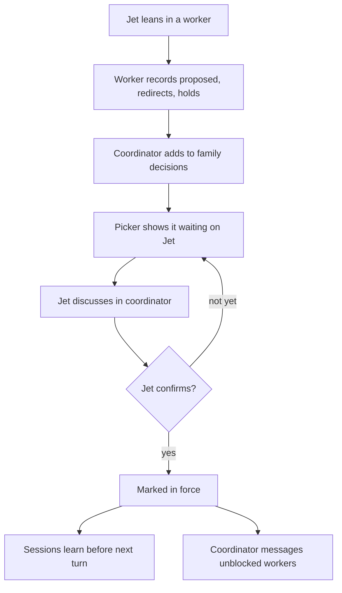
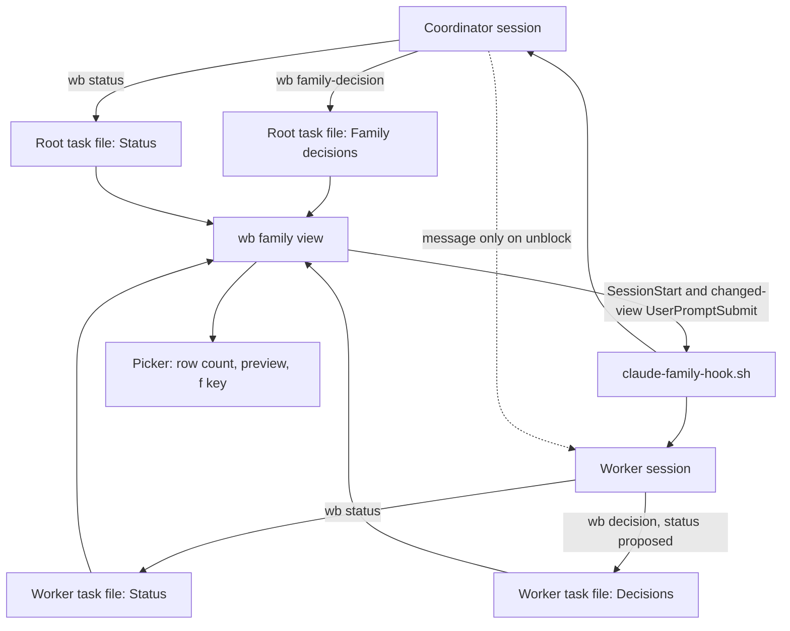
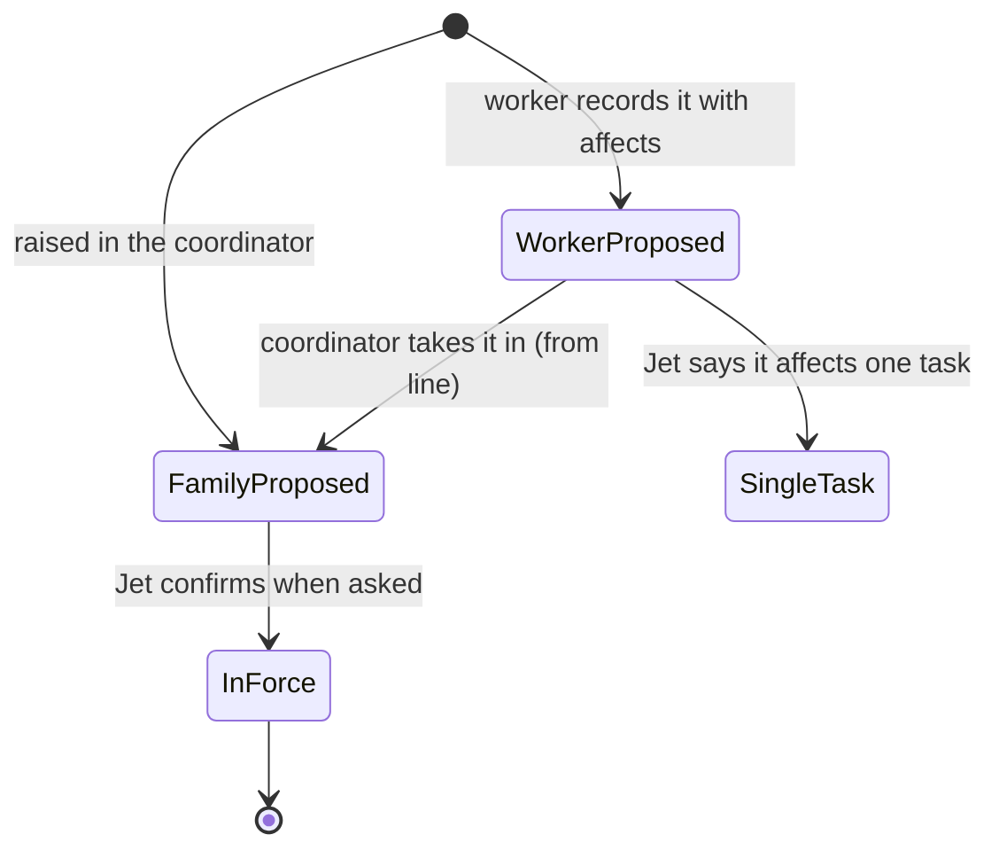

# wb family coordinators - Plan

## Goal Capsule

- **Objective:** When Jet runs two or three overlapping wb tasks as a family, it is always clear what each task is planning, building or reviewing and which decisions are actually confirmed. Every cross-task item has one place to be discussed, and sessions act on the latest decisions in force without Jet reminding them.
- **Means:** An ordinary wb session acts as the family's coordinator and alone writes the family decisions; each worker writes its own status block. The rules live in a skill, a hook keeps sessions current, and the picker surfaces what waits on Jet (approach A, KD8; mechanics in KTD1–KTD6).
- **Product authority:** Jet. Every Key Decision below was put to Jet with options and accepted. On product behaviour the R-IDs win; on mechanism the KTDs win.
- **Open blockers:** none.
- **Execution profile:** bash 5 scripts under `scripts/.config/scripts/tmux/`, a Claude skill under `claude/.claude/skills/`, and the bash test suite. Built in order U1 → U4, then U5 and U6 in either order. U4 is Jet running the first family by hand, and U5 and U6 are built as tasks inside that family (KD7).
- **Stop conditions:** stop and ask Jet if the shared shape (KTD1) can't be parsed reliably by line-oriented tools, if Claude Code's `UserPromptSubmit` hook can no longer inject context, or if the work side changes the shape before U1 lands.
- **Who finishes:** `ce-work` builds U1–U3 and U5–U6 and opens the PRs. Jet does U4 and gives the two-week verdict.

---

## Product Contract

### Summary

Each family gets a coordinator session that alone writes the family decisions: cross-task decisions, each proposed or in force, with the tasks it affects and where it is discussed. Each worker writes its own status block: its phase, what it is touching and what it holds. Nothing is in force until a session asks Jet and Jet confirms. Sessions learn of decisions in force automatically, every reply says whether Jet is needed, and the picker shows what waits on Jet.

### Problem Frame

Jet runs several Claude sessions on related work at once and carries the overall design in their head. On the work machine the main failure was assumed decisions: Jet would ask for clarification and say which way they were leaning, and the session treated the leaning as a decision and relayed it to other sessions. The root cause, in Jet's words, is "not clearly seeing how a decision can impact the full picture design across sessions, when you are multi tasking". Jet also often has to remind sessions of decisions made elsewhere, and it is not always clear which session a given item should be discussed in.

The research for this brainstorm found nothing existing that carries one session's discovery to its siblings, and found that more free-form messaging between agents does not improve coordination. Pointer messages alone would make Jet's failure worse, because a misread leaning would reach siblings faster.

The work machine's own two-day walk-through (4–6 Nov, reported behaviour only) found the same main failure: sessions treated a leaning as decided and relayed it, and Jet found the conflicts only by asking "where was this decided". It also found that relayed messages bury each session's stopping point (8 of 13 sessions on one evening showed the relay rather than the reply Jet needed), that coming back to a session is the biggest cost (in one day: 9 prompts asking what a term means, 9 asking for a diagram, 4 asking where things stand, 3 asking where something was decided), and that 6 of 13 end-of-day replies didn't say whether anything was needed from Jet.

### Actors

- A1. Jet: the only one who confirms decisions.
- A2. Coordinator: an ordinary wb session per family, and the only writer of the family decisions.
- A3. Workers: the family's two or three task sessions, each the only writer of its own status block.

### Key Decisions

- KD1. **One family view covering both decision status and impact.** Status alone stops the symptom, but Jet's root cause is not seeing impact. Governs R3, R4. (session-settled: user-approved — chosen over decision status only, impact only, or carrying discoveries to siblings: covers both the symptom and the root cause in one place)
- KD2. **Seen in the picker first, then the file; the state is plain text a family page can later be generated from.** Governs R12–R14, R17. (session-settled: user-approved — chosen over asking the coordinator, a claude.ai page, or push notifications: it's where Jet already is, it stays plain text, and a coordinator's summary could misstate status. Revised 2026-11-12 after OQ1: the work side found diagrams with status give the big picture fastest and plans a generated HTML family page. Chosen over building that page now or keeping a Mac-only shape: the trial stays small, nothing is built twice, and the two sides converge.)
- KD3. **A decision is confirmed only when a session asks and Jet confirms.** Governs R1, R2. (session-settled: user-approved — chosen over /decide answers only, a keyword Jet types, or the session judging Jet's wording: catches leanings without Jet changing how they talk; judging wording is today's failure)
- KD4. **While proposed, affected workers hold only the dependent part.** Governs R8, R9. (session-settled: user-approved — chosen over building on it marked provisional, stopping entirely, or hiding it until confirmed: nothing gets built on a leaning, and waits become visible)
- KD5. **The coordinator owns the view and judges impact.** Governs R3, R11. (session-settled: user-approved — chosen over no coordinator, or a coordinator that only dispatches and integrates: one session holds the whole picture, which is Jet's root cause)
- KD6. **Cross-task decisions are discussed in the coordinator; single-task ones stay in their task.** Governs R5, R7. (session-settled: user-approved — chosen over discussing wherever it came up, or routing everything through the coordinator: one clear rule, and the full picture is in front of Jet when deciding)
- KD7. **The first family is the wb work under `dotfiles--coordinators`, run by hand once the shared shape, verbs and skill exist, before the hook and picker are built.** The conventions are tried on that family first, and the hook and picker work are built as tasks inside it. This was Jet's own answer when asked which real work could test it.
- KD8. **Conventions plus small hooks, not new record types or enforcement.** (session-settled: user-approved — chosen over making each decision its own store record with a picker view, or adding a hook that blocks edits tied to proposed decisions: the least to build, plain text, and easy to change during the trial)
- KD9. **The work side's vocabulary.** "Family record" is dropped, since "record" already means one entry file in a task's dossier. Family decisions carry `status: proposed` until Jet confirms, then `in-force`, plus `affects: [<child tasks>]`, and only the coordinator writes them. Each child writes its own status block with Phase and Holding lines. The family page is the view generated from both. Governs R1, R3, R4, R17. (session-settled: user-approved 2026-11-12 — chosen over keeping "confirmed" as the status word, or keeping the Mac terms: the same words on both machines eases the migration, and one writer per block avoids contention)
- KD10. **Every family session ends each turn saying whether Jet is needed.** Governs R16. (session-settled: user-approved 2026-11-12 — chosen over also adding a family terms list, a day-start overview by priority, or a day-end refresh now: it is one rule in the coordinator skill and targets the "where things stand" cost; the rest is deferred)

### Requirements

**Decision status**

- R1. Every decision a session records starts as proposed and becomes in force only after the session explicitly asks Jet and Jet confirms; Jet's reply is stored with it.
- R2. No session relays a proposed decision to another session, or records it anywhere, as decided.

**Family decisions and status blocks**

- R3. Each family has one set of family decisions, written only by its coordinator. Each carries its status (proposed or in-force), the tasks it affects (`affects:`), and where it is discussed.
- R4. Each worker writes its own status block: its phase (planning, building or reviewing), what it is touching, and a Holding line saying what it holds for Jet.
- R5. Single-task decisions stay in that task's own Decisions section, and only cross-task decisions become family decisions.
- R6. A finding that is not a decision but affects a sibling takes the same route as a cross-task decision: worker to coordinator, then into the family decisions and on to the affected sessions.

**Where items are discussed**

- R7. When a cross-task decision comes up in a worker, the worker records it as proposed, tells Jet it belongs in the coordinator, and holds the dependent work.

**Holding**

- R8. While a cross-task decision is proposed, each affected worker continues only the work that doesn't depend on it, and its status block's Holding line says what is held.
- R9. When a decision comes into force, the coordinator messages each worker whose held work it unblocks, including idle ones. Only unblocking warrants a message: relays bury a session's stopping point, so everything else reaches sessions through R10.

**Staying current**

- R10. Each session in the family learns about decisions newly in force, and family changes that affect it, before its next turn and whenever it starts, restarts or clears, without Jet prompting it.

**Without a live coordinator**

- R11. When the coordinator isn't running, a worker's cross-task proposals wait as proposed in the worker's own task and still show as waiting on Jet. The coordinator takes them in when it next runs.

**Visibility**

- R12. The family's row in the picker shows how many decisions are waiting on Jet.
- R13. The picker's preview for the family shows the open decisions, with the tasks each affects and where it is discussed, plus each worker's status block.
- R14. A picker key opens the family decisions and status blocks in nvim.

**Replies**

- R16. Every family session's end-of-turn reply says whether anything is needed from Jet, and what, or says that nothing is.

**A shared shape**

- R17. Family decisions and status blocks are plain text in the shape the work side uses, so the family page it plans can be generated from them on either machine.

**Portability**

- R15. Linux and Mac differences go through the existing compat shims, with no Mac-only tool where a portable one exists, as `docs/roadmap.md` requires of all Mac work.

### Key Flows

- F1. A cross-task decision comes up in a worker
  - **Trigger:** Jet says which way they lean on a question in a worker, and the answer would affect a sibling task.
  - **Actors:** A1, A2, A3
  - **Steps:** The worker records the leaning as proposed, tells Jet it belongs in the coordinator, and holds the dependent work. The coordinator adds it to the family decisions with the affected tasks, and the picker shows it as waiting. Jet discusses it in the coordinator, which asks Jet to confirm. Once Jet confirms, the coordinator marks it in force, every family session learns of it before its next turn, and the coordinator messages the workers it unblocks.
  - **Outcome:** One decision in force, discussed in one place, known to every affected session, with no reminder needed from Jet.
  - **Covered by:** R1, R3, R7, R8, R9, R10, R12



- F2. A family session restarts
  - **Trigger:** A worker or the coordinator starts, restarts or clears its context.
  - **Actors:** A2 or A3
  - **Steps:** On pick-up, the session loads the current family decisions and status blocks along with its own task.
  - **Outcome:** It acts on the latest decisions in force and holds without being told.
  - **Covered by:** R10

### Acceptance Examples

- AE1. **Covers R1, R2.** Given Jet says "I'm leaning towards one family file" in a worker, when the worker records it, it is proposed, and the worker asks Jet to confirm before treating it as decided. No other session is told it is decided.
- AE2. **Covers R5.** Given a decision affects only the task it came up in, when Jet confirms it, it lands in that task's Decisions section and not in the family decisions.
- AE3. **Covers R9.** Given a worker is idle and holding work on a proposed decision, when Jet confirms that decision in the coordinator, the coordinator messages the worker, and it picks the held work back up without Jet going to it.
- AE4. **Covers R11.** Given the coordinator isn't running, when a worker records a cross-task proposal, it waits in the worker's own task file, the picker still counts it as waiting on Jet, and the coordinator adds it to the family decisions when it next runs.
- AE5. **Covers R7.** Given Jet raises a cross-task question in a worker, when the worker recognises that it affects a sibling, it tells Jet to take it to the coordinator rather than settling it there.
- AE6. **Covers R16.** Given a worker finishes a turn with nothing waiting on Jet, its reply says so in its last line; given it needs Jet, the line says what for.

### Success Criteria

Judged by Jet after about two weeks on the first family (KD7):

- The mental overhead is gone: what each task is planning, building or reviewing always feels clear.
- There is no confusion about where to discuss a specific item.
- Sessions are aware of the latest decisions without Jet reminding them.
- No leaning was treated as a decision.

### Scope Boundaries

**Deferred for later**

- Decisions as their own store records with a picker view (approach B), if the family decisions get unwieldy.
- The generated family page with a status diagram. The work side builds it first; the Mac ports it at verdict time (KD2, R17).
- A family terms list (the work side's per-family `CONCEPTS.md`), shown in the preview.
- A day-start overview listing families in Jet's priority order from each coordinator's next steps, and a day-end habit where each coordinator refreshes its next steps. The work side plans both.
- Hooks that enforce holds (approach C), if the trial shows sessions ignoring them.
- A Stop-hook prompt asking workers what their siblings need to know (OQ6). R6 rests on the skill's rule during the trial.
- Integrating finished branches one at a time, and a file-overlap check across worktrees, both recommended by the research. Jet's problem is decisions, not merge conflicts.
- `wb adopt` for sessions not started by `wb new`. The first family's tasks come from `wb new --parent`.
- Push notifications and claude.ai pages for the family view.
- Running coordinators on the work machine. That belongs to the migration decision.

**Outside this work**

- Replacing the wb task store, or adding a new store, daemon, heartbeat or merge queue.
- Detecting impact automatically. The coordinator judges it from what workers declare.
- Changing `/handoff` or `/decide`. Both keep working as they are inside a family.

<!-- ce-section: work-relationships -->
### How This Work Fits Together

This plan covers only family coordinators. The rest is current understanding, not a committed roadmap.

- A portable list of the Mac's workflow changes (`docs/wb-mac/work-sync.md`), for Jet to compare against the work repo now, with porting at each feature's keep verdict.
  - Answered OQ1. The work side will adopt KD3–KD6 and R1–R11, and adds the family page, the overview by priority and the day-end refresh.
- The two-week verdicts for the Mac picker, `/handoff` and `/decide` in `docs/wb-mac/comparisons.md`.
  - Can proceed independently. A coordinator verdict joins them after the trial.
- `wb adopt` with a resume path for tasks without a worktree.
  - Still to decide, after this trial shows whether families need it.

### Dependencies / Assumptions

- Cross-session messages are not documented as surviving a restart, and there is no broadcast, so the family decisions are the source of truth and messages only point at them. The work side's relay burial (Problem Frame) argues for R10's hook over messages wherever possible.
- The coordinator can judge impact from what workers declare they are touching. If declarations prove too vague, that is a trial finding, not a planning fix.
- Families already exist through the task `parent:` field, which the picker already nests.
- The pick-up hook already loads a task's checkpoint when a session starts or clears, so R10 extends a path that already exists.

### Outstanding Questions

**Resolved**

- OQ1. Does the work dotfiles repo already have, or plan, something that overlaps coordinators? **Yes** (answered 2026-11-12 from the work side, behaviour only). It has families through `parent:`, a parent session used as coordinator by habit, `[wb-propagate]` decision messaging with no proposed or confirmed status, background decision drafting that Jet accepts without a close read, and a per-family `CONCEPTS.md`. It plans a generated family page, a day-start overview and a day-end refresh. These rules answer its decision problem more completely, so it will adopt them. The answer led to KD2's revision, KD9, KD10, R9's narrowing, R16 and R17.
- OQ2. How a session learns of changes before its next turn (R10): a prompt-time hook, with messages only to wake unblocked workers. See KTD4.
- OQ3. Where the family decisions and status blocks live, and how workers declare what they are touching: sections in the task files, in the shape KTD1 gives.
- OQ4. How a coordinator is started and marked: it is the family's root task's session, started with plain `wb new`. No marker is needed (KTD2).
- OQ5. What the coordinator does when a worker misjudged a decision as single-task: it raises it with Jet in the coordinator and records it as a family decision with `from:` pointing at the worker's entry (KTD3). The worker's entry stays where it is.
- OQ6. Whether a worker's Stop hook should prompt for what siblings need to know: not in the trial (Scope Boundaries).

### Sources / Research

- `docs/roadmap.md`, the "Messaging and family coordinators" row and the Mac test-bed rules.
- The coordinator findings in the `dotfiles--coordinators` task file, under Handoffs, "from dotfiles--backlog-skills-research", 2026-11-05. The file is machine-local in `~/tasks`. They cover CooperBench and AgentRoom on agent messaging, the native messaging limits, and verdicts on CCPM, Seeds, agent-deck and agent teams.
- `docs/brainstorms/2026-10-25-sessions-and-tasks-current-state.md`, on the work machine's per-family `CONCEPTS.md`.
- `docs/wb-mac/comparisons.md`, which records `[wb-propagate]` as left out of the Mac build.
- The work side's answer to OQ1 (2026-11-12, behaviour only, checked by Jet before it was brought over), including its 4–6 Nov walk-through.
- `scripts/.config/scripts/tmux/wb-lib/rows.sh` (family nesting by `parent:`) and `scripts/.config/scripts/tmux/wb-lib/card.sh` (the picker preview).

---

## Planning Contract

### Key Technical Decisions

- KTD1. **The shared shape is two task-file sections in the existing markdown format.** The family root's task file gets a `## Family decisions` section, and every task in the family, the root included, gets a `## Status` section. A family decision is a `### <title>` entry with `status:` (`proposed`, `in-force`, or `declined` when Jet says no), `affects:`, `discussed in:` and, once Jet answers, `confirmed:` lines, followed by free prose and Jet's reply. A status block holds `Phase:`, `Touching:`, `Holding:` and `Updated:` lines. Line-prefixed fields keep the shape greppable by awk on both machines and generatable into the work side's page (R17). Governs R3, R4, R17. (session-settled: user-approved — chosen over one shared family file, or the decisions in each child's file: one writer per block, and the root already is the family's anchor)
- KTD2. **The family root's task is the coordinator.** The root is the task with no `parent:` that others name as `parent:`, so no marker or new frontmatter field is needed, and `wb new` starts it as usual. Governs R3, KD5. (session-settled: user-approved — chosen over a `role: coordinator` field or a separate coordinator task: the picker already nests families under that root)
- KTD3. **Proposals always start in the worker.** A worker records a cross-task leaning in its own Decisions section through `wb decision`, with `status: proposed` and `affects:` lines. The coordinator takes it in by writing a family decision with a `from: <stem> / <title>` line. A worker proposal with no family decision citing it counts as waiting on Jet. This covers the coordinator being away (R11) and the misjudged single-task case (OQ5) without a second writer on any block. Governs R7, R11, R6. (session-settled: user-approved — chosen over the worker writing straight into the family decisions: that would break KD9's one writer per block)
- KTD4. **A new hook keeps every family session current.** `claude-family-hook.sh` runs on `SessionStart` and `UserPromptSubmit`. It prints the family view (KTD5's `wb family`) as added context at session start, and again before a prompt only when the view changed since that session last saw it, tracked by a hash under `$WB_STATE_DIR/family-seen/<session id>`. The hash leaves out `Updated:` lines and the reading session's own `## Status` block, so routine status writes don't re-inject the view every turn. Messages go only to wake workers whose held work a decision unblocks (R9). Governs R10, R9. (session-settled: user-approved — chosen over messages for every change, or both: relays bury stopping points, and an unchanged view adds nothing to a prompt)
- KTD5. **New wb verbs, all writes through the task lock.** `wb family-decision <title>` (stdin, replaces or appends in the root's `## Family decisions`), `wb status` (stdin, replaces this task's `## Status`), and `wb family [--waiting|--edit]` (prints the view, the waiting count, or opens the files in nvim). The view lists open decisions first, then in-force ones, then each task's status block, then untaken worker proposals. Governs R3, R4, R12–R14.
- KTD6. **A `family` skill plus the hook's reminder carry the rules; nothing enforces them.** The skill states R1, R2, R5–R9, R11 and R16 as instructions and names the verbs. The hook's injected context opens with a one-line reminder to follow the skill. `/handoff` and `/decide` are unchanged. Governs R1, R2, R16, KD8. (session-settled: user-approved — chosen over editing /handoff and /decide, or hooks that block edits: smallest change, easy to adjust during the trial)

### High-Level Technical Design

This sketch shows the intended shape and is not a specification to copy.

Who writes and reads what:



A cross-task decision's states:



`WorkerProposed` and `FamilyProposed` both count as waiting on Jet.

The text shape, directionally:

```markdown
## Family decisions

### One family view for status and impact
status: proposed
affects: [dotfiles--family-hook, dotfiles--family-picker]
discussed in: dotfiles--coordinators
from: dotfiles--family-hook / Hook reads the view

Why it matters, in a line or two.

## Status

Phase: building
Touching: scripts/.config/scripts/tmux/claude-family-hook.sh
Holding: the picker count, until "One family view" is in force
Updated: 2026-11-14 10:20
```

### Assumptions

- `UserPromptSubmit` hooks can return `hookSpecificOutput.additionalContext`, as the `SessionStart` pick-up hook already does.
- The family is small (two or three workers), so printing the whole view on change stays well under the 10,000-character context field. The pick-up hook's budget trim (`WB_PICKUP_BUDGET`) is the pattern if it doesn't.
- The coordinator messages workers through Claude Code's session messaging (ListAgents and SendMessage), as the `coordinate-parallel-sessions` habit already does.

### Sequencing

U1 → U2 → U3 → U4, then U5 and U6 in either order, built as tasks inside the first family (KD7). U4 is Jet's, and its findings may change U5 and U6 before they start.

---

## Implementation Units

### U1. Family view: read the shared shape

- **Goal:** One function and verb print a family's decisions, status blocks and untaken worker proposals, and count what waits on Jet.
- **Requirements:** R3, R4, R11, R12, R13, R17; KTD1, KTD2, KTD3, KTD5.
- **Dependencies:** none.
- **Files:** `scripts/.config/scripts/tmux/wb-lib/family.sh` (new), `scripts/.config/scripts/tmux/wb` (dispatch and help text), `scripts/.config/scripts/tmux/tests/family.test.sh` (new).
- **Approach:** Find the root from any member by walking `parent:` (reuse `wb_family_tree` in `wb-lib/store.sh`), and skip members whose `status:` is `done`. Parse sections with awk in the style of `wb_task_pickup` and `wb_task_set_decision`. `wb family` defaults to this session's task (`wb_task_for_session`) and takes `--task`. `--waiting` prints only the count.
- **Patterns:** `wb-lib/store.sh` (section awk, `wb_family_tree`), `wb-lib/handoff.sh` (`--task` / `--session-id` handling).
- **Test scenarios:**
  - A root with two proposed and one in-force family decision and two children with status blocks: the view lists the proposed ones first, then in force, then each status block, and `--waiting` prints 2.
  - A worker Decisions entry with `status: proposed` and `affects:` that no family decision cites: it shows under worker proposals and adds 1 to the count.
  - The same entry once a family decision has `from: <stem> / <title>`: it is no longer listed or counted.
  - A worker entry with no `affects:` line is single-task and never appears (AE2).
  - Called from a child, a grandchild or the root: the same view.
  - A task with no family, and a `parent:` cycle: prints nothing, exits non-zero, does not loop.
  - A task file with no `## Family decisions` or `## Status` section: shown as empty, no error.
  - A `status: done` child with a status block and an untaken proposal: neither listed nor counted.
- **Verification:** `bash scripts/.config/scripts/tmux/tests/run-tests.sh family` passes.

### U2. Write verbs: family decisions and status blocks

- **Goal:** The coordinator writes family decisions and every task writes its own status block, each through the task lock.
- **Requirements:** R1, R3, R4, R8; KTD1, KTD5.
- **Dependencies:** U1.
- **Files:** `scripts/.config/scripts/tmux/wb-lib/family.sh`, `scripts/.config/scripts/tmux/wb`, `scripts/.config/scripts/tmux/tests/family.test.sh`.
- **Approach:** `wb family-decision <title>` reuses `wb_task_set_decision`'s replace-or-append logic, generalised to take the section name, and writes to the root's file. `wb status` replaces the whole `## Status` section and stamps `Updated:`. Both take the lock the way `cmd_decision` does. `wb family-decision` warns, without refusing, when the caller isn't the root's session (KD8).
- **Patterns:** `cmd_decision` in `wb-lib/handoff.sh`, `wb_task_set_decision` in `wb-lib/store.sh`.
- **Test scenarios:**
  - A new family decision lands in a new `## Family decisions` section placed before `## Done`, and the file's other sections are byte-identical.
  - Writing the same title again replaces the entry, so flipping `status: proposed` to `in-force` leaves one entry.
  - `wb status` twice leaves one `## Status` section holding the second body and a fresh `Updated:` line.
  - Run from a worker session, `wb family-decision` writes to the root's file and prints a warning.
  - Two writers to the same file at once both land (lock held), checked with the existing store lock test's approach.
  - Existing `wb decision` behaviour is unchanged after the generalisation: `store.test.sh` still passes.
- **Verification:** `bash scripts/.config/scripts/tmux/tests/run-tests.sh` passes in full.

### U3. The family skill

- **Goal:** One skill tells coordinators and workers how to act in a family.
- **Requirements:** R1, R2, R5, R6, R7, R8, R9, R11, R16; KTD3, KTD6.
- **Dependencies:** U2.
- **Files:** `claude/.claude/skills/family/SKILL.md` (new).
- **Approach:** Two short parts, one for the coordinator and one for workers, in the style of the `handoff` and `decide` skills. Each rule cites the verb that carries it. The coordinator part covers taking in worker proposals, asking Jet to confirm, recording Jet's reply, messaging only unblocked workers, and the same end-of-turn "Needs you" line (R16). The worker part covers recording a leaning as proposed, redirecting Jet to the coordinator (AE5), keeping the status block's Holding line current, and the end-of-turn "Needs you" line (R16). That line uses the heading `_wb_card_questions` in `wb-lib/card.sh` already reads, so the preview picks it up. The skill tells sessions to put decisions to Jet with options as `/decide` does.
- **Test expectation:** none -- a prose skill; U4 exercises it on real work.
- **Verification:** The skill loads by name in a fresh session, and a dry read shows each of R1, R2, R5–R9, R11 and R16 stated once.

### U4. Run the first family by hand

- **Goal:** Jet tries the conventions on real work before the hook and picker exist (KD7).
- **Requirements:** KD7; exercises R1–R9, R11, R16.
- **Dependencies:** U3.
- **Files:** none in the repo. The family is `dotfiles--coordinators` as root, with children made by `wb new --parent dotfiles--coordinators` for U5 and U6.
- **Approach:** The coordinator and workers load the family skill by hand and run `wb family` themselves instead of relying on the hook. Findings go into the coordinator's task file as Handoffs entries, and any change to U5 or U6 goes back into this plan before they start.
- **Test expectation:** none -- a manual trial; its findings are the output.
- **Verification:** At least one cross-task decision went from proposed to in force through the coordinator, and Jet has said whether U5 and U6 still stand as written.

### U5. The family hook

- **Goal:** Every family session sees the current family view at start and whenever it changed, without Jet prompting it.
- **Requirements:** R10, R9; KTD4, KTD6.
- **Dependencies:** U1; built inside the family after U4.
- **Files:** `scripts/.config/scripts/tmux/claude-family-hook.sh` (new), `scripts/.config/scripts/tmux/claude-hooks-merge.sh`, `scripts/.config/scripts/tmux/tests/claude-family-hook.test.sh` (new), `scripts/.config/scripts/tmux/tests/wiring.test.sh`.
- **Approach:** Follow `claude-pickup-hook.sh`: read `session_id` and `hook_event_name` from stdin, check bash 5, source `wb`, find the task, exit 0 silently when it has no family. On `SessionStart` (every source) print the view and store its hash. On `UserPromptSubmit` print it only when the hash differs (KTD4 says what the hash leaves out). A done task's session exits silently. The context opens with the skill reminder, and is trimmed to a budget like `WB_PICKUP_BUDGET`. Add both events to `claude-hooks-merge.sh`. Hash with POSIX `cksum`, present on both machines, so no new compat shim is needed (R15).
- **Patterns:** `claude-pickup-hook.sh`, `tests/claude-pickup-hook.test.sh`.
- **Test scenarios:**
  - A family session's `SessionStart` prints JSON whose `additionalContext` holds the reminder line and the view.
  - Two `UserPromptSubmit` calls with no change between: the first after start prints nothing, and the second prints nothing.
  - After `wb family-decision` flips a decision to in-force, the next `UserPromptSubmit` prints the view once, and the one after prints nothing.
  - A worker runs `wb status`, and its next `UserPromptSubmit` prints nothing. A sibling's `wb status` that changes only `Updated:` also prints nothing.
  - A session whose task has no family, a session with no task, and bash older than 5: exit 0 with no output.
  - A view longer than the budget is trimmed with a pointer to `wb family`.
  - `claude-hooks-merge.sh` run twice adds each hook entry once (`wiring.test.sh`).
- **Verification:** Hook tests pass. In a live family, confirming a decision in the coordinator shows it in a worker's next turn without a message. After a `/clear`, both the pick-up checkpoint and the family view reach the session untrimmed, since both hooks add context on the same `SessionStart`.

### U6. Family in the picker

- **Goal:** Jet sees from the picker what waits on them in each family and can open it.
- **Requirements:** R12, R13, R14, R15; KTD5.
- **Dependencies:** U1; built inside the family after U4.
- **Files:** `scripts/.config/scripts/tmux/wb-lib/rows.sh`, `scripts/.config/scripts/tmux/wb-lib/card.sh`, `scripts/.config/scripts/tmux/wb-lib/picker.sh`, `scripts/.config/scripts/tmux/tests/picker-rows.test.sh`, `scripts/.config/scripts/tmux/tests/card.test.sh`, `scripts/.config/scripts/tmux/tests/picker-actions.test.sh`.
- **Approach:** The row that anchors the family's block shows the `wb family --waiting` count when it is above zero: the root's row when the root is live, otherwise the earliest-created child that `_collect_combined_blocks` in `wb-lib/rows.sh` already groups siblings under (R11, AE4). A waiting count counts as needing Jet, so `u` jumps to it. The root's preview adds a Family section from `wb family` above the transcript card. Bind `f` (free in normal mode; add it to `navkeys` in `wb-lib/picker.sh` so search mode unbinds it) to `wb family --edit` on the focused row's task, which opens the root and each member's file in nvim at the relevant sections. Keep the render's per-row cost bounded by computing each family's count once per render.
- **Patterns:** the needs-you handling in `wb-lib/rows.sh` and `wb-lib/decide.sh`, `wb_card` sections in `wb-lib/card.sh`, existing binds in `wb-lib/picker.sh`.
- **Test scenarios:**
  - A root with 2 waiting shows a "2 to decide" marker, and its row counts as needing Jet for `u`.
  - A root with 0 waiting renders exactly as it does today.
  - A child row shows the count only when it anchors a family whose root has no row.
  - AE4: root not live and one untaken worker proposal: the anchoring child row shows "1 to decide" and `u` jumps to it.
  - The root's preview lists open decisions with their `affects:` and `discussed in:`, then each status block.
  - `f` on a child row opens the same files as `f` on the root.
  - A render with three families reads each family's files once (count the calls).
- **Verification:** Picker tests pass, and the live picker shows the first family's waiting count change as decisions are confirmed.

---

## Verification Contract

| Gate | Command | Applies to |
|---|---|---|
| Full wb suite | `bash scripts/.config/scripts/tmux/tests/run-tests.sh` | U1, U2, U5, U6 |
| One area | `bash scripts/.config/scripts/tmux/tests/run-tests.sh <name>` (for example `family`, `claude-family-hook`, `picker`) | while building each unit |
| Lint | `bash scripts/.config/scripts/tmux/tests/run-tests.sh lint` | every unit that adds or changes a script |
| Hook wiring | `bash scripts/.config/scripts/tmux/tests/run-tests.sh wiring` | U5 |
| Live check | the first family in the real picker and sessions | U4, U5, U6 |

The suite needs bash 5, `jq` and `tmux` on PATH, as the existing tests do.

## Definition of Done

- Every unit's verification above is met, and the full suite passes on the Mac.
- `wb help` lists the new verbs, and `docs/wb-mac/work-sync.md` describes the shared shape (KTD1) so the work side can check it matches.
- `docs/wb-mac/comparisons.md` has a coordinators section with its verdict open, judged against the Success Criteria after about two weeks.
- No Mac-only tool is introduced where `compat.sh` has a shim (R15).
- Code from approaches tried and abandoned during the build is removed from the diff.
