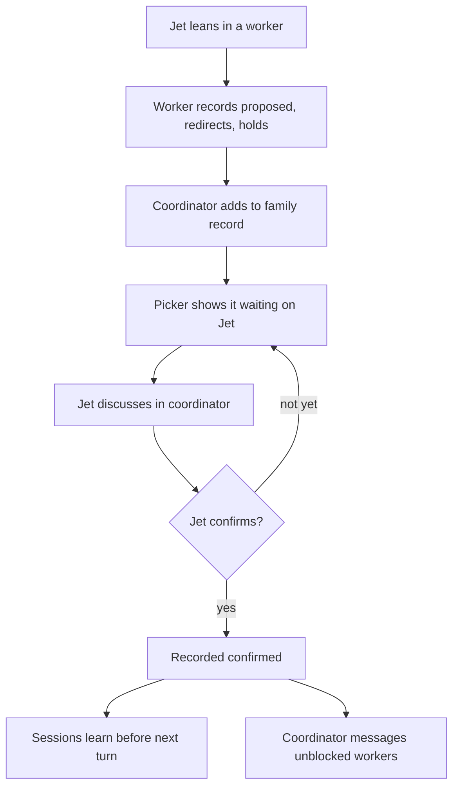

# wb family coordinators - Plan

## Goal Capsule

- **Objective:** When Jet runs two or three overlapping wb tasks as a family, it is always clear what each task is planning, building or reviewing and which decisions are actually confirmed. Every cross-task item has one place to be discussed, and sessions act on the latest confirmed decisions without Jet reminding them.
- **Means:** An ordinary wb session acts as the family's coordinator and owns one family record. The rules live in a skill, a hook keeps sessions current, and the picker surfaces what waits on Jet (approach A, KD8).
- **Product authority:** Jet. Every Key Decision below was put to Jet with options and accepted.
- **Open blockers:** one question to resolve before planning (OQ1): whether the work dotfiles repo already has or plans something overlapping.

---

## Product Contract

### Summary

Each family gets a coordinator session and a record it alone writes: cross-task decisions with their status, the tasks they affect and where they are discussed, plus what each worker is doing and holding. Nothing counts as decided until a session asks Jet and Jet confirms. Sessions learn of confirmed decisions automatically, and the picker shows what waits on Jet.

### Problem Frame

Jet runs several Claude sessions on related work at once and carries the overall design in their head. On the work machine the main failure was assumed decisions: Jet would ask for clarification and say which way they were leaning, and the session treated the leaning as a decision and relayed it to other sessions. The root cause, in Jet's words, is "not clearly seeing how a decision can impact the full picture design across sessions, when you are multi tasking". Jet also often has to remind sessions of decisions made elsewhere, and it is not always clear which session a given item should be discussed in.

The research for this brainstorm found nothing existing that carries one session's discovery to its siblings, and found that more free-form messaging between agents does not improve coordination. Pointer messages alone would make Jet's failure worse, because a misread leaning would reach siblings faster.

### Actors

- A1. Jet: the only one who confirms decisions.
- A2. Coordinator: an ordinary wb session per family, and the only writer of the family record.
- A3. Workers: the family's two or three task sessions.

### Key Decisions

- KD1. **One family view covering both decision status and impact.** Status alone stops the symptom, but Jet's root cause is not seeing impact. Governs R3, R4. (session-settled: user-approved — chosen over decision status only, impact only, or carrying discoveries to siblings: covers both the symptom and the root cause in one place)
- KD2. **Seen in the picker first, then the file.** Governs R12–R14. (session-settled: user-approved — chosen over asking the coordinator, a claude.ai page, or push notifications: it's where Jet already is, it stays plain text, and a coordinator's summary could misstate status)
- KD3. **A decision is confirmed only when a session asks and Jet confirms.** Governs R1, R2. (session-settled: user-approved — chosen over /decide answers only, a keyword Jet types, or the session judging Jet's wording: catches leanings without Jet changing how they talk; judging wording is today's failure)
- KD4. **While proposed, affected workers hold only the dependent part.** Governs R8, R9. (session-settled: user-approved — chosen over building on it marked provisional, stopping entirely, or hiding it until confirmed: nothing gets built on a leaning, and waits become visible)
- KD5. **The coordinator owns the view and judges impact.** Governs R3, R11. (session-settled: user-approved — chosen over no coordinator, or a coordinator that only dispatches and integrates: one session holds the whole picture, which is Jet's root cause)
- KD6. **Cross-task decisions are discussed in the coordinator; single-task ones stay in their task.** Governs R5, R7. (session-settled: user-approved — chosen over discussing wherever it came up, or routing everything through the coordinator: one clear rule, and the full picture is in front of Jet when deciding)
- KD7. **The first family is the wb work under `dotfiles--coordinators`, run by hand before anything is built.** The conventions are tried on that family first, and the hook and picker work are built as tasks inside it. This was Jet's own answer when asked which real work could test it.
- KD8. **Conventions plus small hooks, not new record types or enforcement.** (session-settled: user-approved — chosen over making each decision its own store record with a picker view, or adding a hook that blocks edits tied to proposed decisions: the least to build, plain text, and easy to change during the trial)

### Requirements

**Decision status**

- R1. Every decision a session records starts as proposed and becomes confirmed only after the session explicitly asks Jet and Jet confirms; Jet's reply is stored with it.
- R2. No session relays a proposed decision to another session, or records it anywhere, as decided.

**The family record**

- R3. Each family has one record, written only by its coordinator, listing each cross-task decision with its status, the tasks it affects, and where it is discussed.
- R4. The record also has one entry per worker: its phase (planning, building or reviewing), what it is touching, and what it is holding for Jet.
- R5. Single-task decisions stay in that task's own record, and only cross-task decisions enter the family record.
- R6. A finding that is not a decision but affects a sibling takes the same route as a cross-task decision: worker to coordinator, then into the record and on to the affected sessions.

**Where items are discussed**

- R7. When a cross-task decision comes up in a worker, the worker records it as proposed, tells Jet it belongs in the coordinator, and holds the dependent work.

**Holding**

- R8. While a cross-task decision is proposed, each affected worker continues only the work that doesn't depend on it, and its record entry says what is held.
- R9. When a decision is confirmed, the coordinator messages each worker whose held work it unblocks, including idle ones.

**Staying current**

- R10. Each session in the family learns about newly confirmed decisions, and record changes that affect it, before its next turn and whenever it starts, restarts or clears, without Jet prompting it.

**Without a live coordinator**

- R11. When the coordinator isn't running, a worker's cross-task proposals wait as proposed in the worker's own task record and still show as waiting on Jet. The coordinator takes them in when it next runs.

**Visibility**

- R12. The family's row in the picker shows how many decisions are waiting on Jet.
- R13. The picker's preview for the family shows the open decisions, with the tasks each affects and where it is discussed, plus each worker's phase and what it holds.
- R14. A picker key opens the full family record in nvim.

**Portability**

- R15. Linux and Mac differences go through the existing compat shims, with no Mac-only tool where a portable one exists, as `docs/roadmap.md` requires of all Mac work.

### Key Flows

- F1. A cross-task decision comes up in a worker
  - **Trigger:** Jet says which way they lean on a question in a worker, and the answer would affect a sibling task.
  - **Actors:** A1, A2, A3
  - **Steps:** The worker records the leaning as proposed, tells Jet it belongs in the coordinator, and holds the dependent work. The coordinator adds it to the family record with the affected tasks, and the picker shows it as waiting. Jet discusses it in the coordinator, which asks Jet to confirm. Once Jet confirms, the coordinator records it as confirmed, every family session learns of it before its next turn, and the coordinator messages the workers it unblocks.
  - **Outcome:** One confirmed decision, discussed in one place, known to every affected session, with no reminder needed from Jet.
  - **Covered by:** R1, R3, R7, R8, R9, R10, R12

- F2. A family session restarts
  - **Trigger:** A worker or the coordinator starts, restarts or clears its context.
  - **Actors:** A2 or A3
  - **Steps:** On pick-up, the session loads the family record's current state along with its own task.
  - **Outcome:** It acts on the latest confirmed decisions and holds without being told.
  - **Covered by:** R10

### Acceptance Examples

- AE1. **Covers R1, R2.** Given Jet says "I'm leaning towards one family file" in a worker, when the worker records it, it is proposed, and the worker asks Jet to confirm before treating it as decided. No other session is told it is decided.
- AE2. **Covers R5.** Given a decision affects only the task it came up in, when Jet confirms it, it lands in that task's Decisions section and not in the family record.
- AE3. **Covers R9.** Given a worker is idle and holding work on a proposed decision, when Jet confirms that decision in the coordinator, the coordinator messages the worker, and it picks the held work back up without Jet going to it.
- AE4. **Covers R11.** Given the coordinator isn't running, when a worker records a cross-task proposal, it waits in the worker's own record, the picker still counts it as waiting on Jet, and the coordinator adds it to the family record when it next runs.
- AE5. **Covers R7.** Given Jet raises a cross-task question in a worker, when the worker recognises that it affects a sibling, it tells Jet to take it to the coordinator rather than settling it there.

### Success Criteria

Judged by Jet after about two weeks on the first family (KD7):

- The mental overhead is gone: what each task is planning, building or reviewing always feels clear.
- There is no confusion about where to discuss a specific item.
- Sessions are aware of the latest decisions without Jet reminding them.
- No leaning was treated as a decision.

### Scope Boundaries

**Deferred for later**

- Decisions as their own store records with a picker view (approach B), if the family record gets unwieldy.
- Hooks that enforce holds (approach C), if the trial shows sessions ignoring them.
- Integrating finished branches one at a time, and a file-overlap check across worktrees, both recommended by the research. Jet's problem is decisions, not merge conflicts.
- `wb adopt` for sessions not started by `wb new`. The first family's tasks come from `wb new --parent`.
- Push notifications and claude.ai pages for the family view.
- Running coordinators on the work machine. That belongs to the migration decision.

**Outside this work**

- Replacing the wb task store, or adding a new store, daemon, heartbeat or merge queue.
- Detecting impact automatically. The coordinator judges it from what workers declare.

<!-- ce-section: work-relationships -->
### How This Work Fits Together

This plan covers only family coordinators. The rest is current understanding, not a committed roadmap.

- A portable list of the Mac's workflow changes, for Jet to compare against the work repo now, with porting at each feature's keep verdict.
  - Feeds OQ1, and can proceed independently of this plan.
- The two-week verdicts for the Mac picker, `/handoff` and `/decide` in `docs/wb-mac/comparisons.md`.
  - Can proceed independently. A coordinator verdict joins them after the trial.
- `wb adopt` with a resume path for tasks without a worktree.
  - Still to decide, after this trial shows whether families need it.

### Dependencies / Assumptions

- Cross-session messages are not documented as surviving a restart, and there is no broadcast, so the family record is the source of truth and messages only point at it.
- The coordinator can judge impact from what workers declare they are touching. If declarations prove too vague, that is a trial finding, not a planning fix.
- Families already exist through the task `parent:` field, which the picker already nests.
- The pick-up hook already loads a task's checkpoint when a session starts or clears, so R10 extends a path that already exists.

### Outstanding Questions

**Resolve Before Planning**

- OQ1. Does the work dotfiles repo already have, or plan, something that overlaps coordinators? Jet answers this from the portable list of Mac changes, without bringing employer details into this repo.

**Deferred to Planning**

- OQ2. How a session learns of changes before its next turn (R10): a prompt-time hook, a message, or both.
- OQ3. Where the family record lives and how workers declare what they are touching (R3, R4).
- OQ4. How a coordinator is started for a family, and how it is marked as the coordinator.
- OQ5. What the coordinator does when a worker misjudges a decision as single-task.
- OQ6. Whether a worker's Stop hook should prompt for anything its siblings need to know (R6).

### Sources / Research

- `docs/roadmap.md`, the "Messaging and family coordinators" row and the Mac test-bed rules.
- The coordinator findings in the `dotfiles--coordinators` task record, under Handoffs, "from dotfiles--backlog-skills-research", 2026-11-05. The record is machine-local in `~/tasks`. They cover CooperBench and AgentRoom on agent messaging, the native messaging limits, and verdicts on CCPM, Seeds, agent-deck and agent teams.
- `docs/brainstorms/2026-10-25-sessions-and-tasks-current-state.md`, on the work machine's per-family `CONCEPTS.md`.
- `docs/wb-mac/comparisons.md`, which records `[wb-propagate]` as left out of the Mac build. Jet hasn't seen it in action on the work machine.
- `scripts/.config/scripts/tmux/wb-lib/rows.sh` (family nesting by `parent:`) and `scripts/.config/scripts/tmux/wb-lib/card.sh` (the picker preview).
